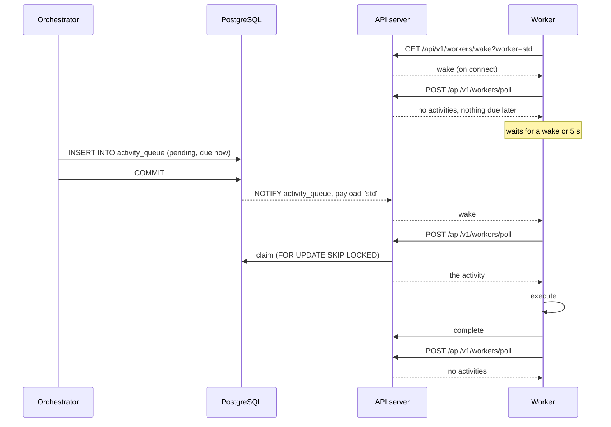

# Activity wake for workers over SSE

**Date:** 2026-11-08 · **Status:** implemented, tested and benchmarked (§6); Python SDK not started · **Target release:** 0.10.0
**Scope:** one migration, `kruxiaflow-core` (wake listener, activity queue), `kruxiaflow-api` (one new endpoint, one new response field), `kruxiaflow-worker` (the Rust worker SDK, which the built-in `std` worker uses), docs, benchmark.

This plan gives workers the latency that `2026-11-08-commit-order-cursor-and-notify-wake.md` gave event consumers: a worker learns that an activity is claimable when the transaction that made it claimable commits, not when its poll timer next fires. The claim itself is unchanged. Workers still claim over `POST /api/v1/workers/poll`, and the built-in worker gets no private path: it opens the same stream through the API as any external worker.

## 1. The problem

After the event wake, the benchmark (`benchmarks/README.md`, 2026-11-08) shows where a workflow's time now goes:

| Step                                                            | Time         | Bound by                               |
|-----------------------------------------------------------------|--------------|----------------------------------------|
| Orchestrator reacts to an event (quiet system)                  | 2 to 6 ms    | Processing                             |
| Activity round trip, `ActivityScheduled` to `ActivityCompleted` | 65 to 100 ms | The worker's activity-queue poll timer |

The worker SDK's loop (`worker-sdk/src/poller.rs`) polls, and after an empty poll sleeps a fixed `poll_interval` (100 ms by default, and 100 ms in the built-in worker). An activity scheduled just after a poll waits for the rest of that interval. A quiet Sequential-5 workflow takes about 500 ms end to end, and about 450 ms of that is five such waits.

The fixed interval also has an idle cost: every idle worker process makes ten authenticated HTTP requests a second, each running the claim query, whether or not there is ever work. On a small host (the Raspberry Pi deployment) that is most of an idle server's load.

## 2. The design

### 2.1 When an activity becomes claimable

The claim query (`PostgresQueue::claim_next`) takes rows for a worker type that are either `pending` with `scheduled_for <= now()`, or `running` past their timeout with retries left. A row enters one of those states in exactly four ways, and they differ in what makes them claimable:

| How                                                           | Written by                          | Claimable when                    |
|---------------------------------------------------------------|-------------------------------------|-----------------------------------|
| Scheduled for now                                             | `schedule` (insert)                 | The inserting transaction commits |
| Returned to pending for now                                   | `reclaim_stale_activities` (update) | That transaction commits          |
| Scheduled for later (`delay`, `scheduled_for`, retry backoff) | `schedule`, `fail` (insert, update) | The clock reaches `scheduled_for` |
| Running past its timeout                                      | Nothing                             | The clock reaches the deadline    |

A commit can be announced; the clock cannot. So the design has two parts: a notification for the first two rows, and for the third a way for the worker to know how long to wait. The fourth is left to the worker's safety-net timer and the orchestrator's existing 30-second stale sweep (which turns it into the second row).

Unlike the event cursor, there is nothing between a commit and claimability: the claim is an ordinary read-committed statement with no transaction-id gate, so a row is claimable by any statement that starts after its commit.

### 2.2 Notification

A row-level trigger on `activity_queue` fires after an insert, or an update of `status` or `scheduled_for`, when the new row is `pending`, and sends a notification on the channel `activity_queue` with the row's worker type as payload. Postgres delivers it at commit and collapses identical notifications within a transaction. The claim's own update (to `running`), heartbeats and completions do not match the condition and cost nothing.

The payload is a routing hint, not data: it decides which workers are woken, and a worker that is woken always asks the queue what is claimable. A lost, duplicated or misrouted notification can only delay a claim until the timer.

The trigger also fires for rows scheduled for later. That is deliberate (§2.5): the wake makes the worker poll, and the poll's answer tells it when the row is due.

### 2.3 Fan-out in the API process

Each API-serving process (`serve`, `api`) already holds one `LISTEN` connection for workflow events. The same connection also listens on `activity_queue`, and the listener task keeps one wake counter per worker type, created on first subscription. The existing rules carry over: a listener reconnect or error wakes every subscriber of every worker type, because notifications sent meanwhile are gone.

`KRUXIAFLOW_EVENT_WAKE=poll`, or a failed `LISTEN`, disables both channels together. In that state the process has no activity wake and says so to workers (§2.4).

Every API instance has its own listener, so in a multi-instance deployment each instance wakes the workers connected to it and no coordination is needed.

### 2.4 The stream

`GET /api/v1/workers/wake?worker=<type>`, authenticated like the other worker endpoints, answers with `text/event-stream`:

- one `wake` event immediately on connection, so anything committed between the worker's last poll and its subscription is not missed;
- one `wake` event for each notification for that worker type (notifications arriving faster than the client reads coalesce into one);
- a comment line every 15 seconds as a keepalive;
- end of stream when the server begins shutdown.

Events carry no data. When the process has no activity wake (§2.3) the endpoint answers 503, which tells the worker to stay on its timer.

SSE is chosen over the alternatives for these reasons:

- **Against long-polling the claim:** the SDK deliberately never cancels a poll in flight, because the server may already have assigned work that would then be stranded until its timeout. A held poll would make worker shutdown wait out the hold. With a separate stream the claim stays a short request the worker starts itself.
- **Against WebSocket:** the channel is one-way, the worker is not a browser (so it can send an `Authorization` header), and SSE is plain HTTP that needs no upgrade support from proxies. `docs/architecture.md` already records SSE as the better fit for one-way streams.

### 2.5 Knowing when to poll next

When a poll claims nothing, the response gains one optional field: the time until the earliest pending activity for that worker type becomes due, if any is scheduled for later. It is computed in the database as a duration (not a timestamp), so the worker's clock is not involved, and the worker arms its timer after receiving it, so the timer cannot fire early.

That gives the worker loop three reasons to poll, whichever comes first:

1. a `wake` arrives;
2. the "next due" time from its last empty poll passes;
3. its idle timer fires.

A wake that arrives while a poll is in flight must not be lost: the loop notes the wake counter before polling, so a wake during the poll makes the next wait return at once.

### 2.6 The worker's timer

| Stream state                                   | Wait after an empty poll                                           |
|------------------------------------------------|--------------------------------------------------------------------|
| Connected                                      | Until a wake, or "next due", or `wake_poll_interval` (default 5 s) |
| Not connected (old server, 503, proxy, outage) | `poll_interval` (default 100 ms), as today                         |

The long interval is only ever used while the stream is connected, so a worker that cannot get a stream behaves exactly as it does now. A stream that ends or errors counts as a wake, and the worker reconnects with backoff (1 s to 30 s). A response that says the endpoint does not exist or is unavailable (404, 405, 501, 503) is retried once a minute. A stream with no bytes for 45 seconds (three missed keepalives) is treated as dead.

Worker configuration, environment and builder as for the existing settings:

- `KRUXIAFLOW_WORKER_WAKE` = `sse` (default) or `poll` (never open the stream);
- `KRUXIAFLOW_WORKER_WAKE_POLL_INTERVAL`, seconds, default 5.

The sequence for one activity, with the stream connected:

### 2.7 Costs and limits

- **Thundering herd.** A notification wakes every idle worker process of that type, and each polls; all but the winners get an empty answer. `SKIP LOCKED` makes this safe. The cost is one wasted request per idle worker per activity, where today each idle worker wastes ten a second regardless. Waking one subscriber at a time is possible later and is not planned here.
- **Timeout expiry is slower to notice.** A `running` activity past its timeout is picked up within `wake_poll_interval` (5 s) by a worker's timer, or by the orchestrator's 30 s sweep, where today a worker notices within 100 ms. Activity timeouts are seconds to minutes, so this is accepted.
- **Many delayed activities.** The "next due" lookup runs only after an empty claim and reads the worker type's pending rows through the existing claim index. With a very large backlog of future-dated rows for one worker type it would warrant its own index; none is added now.
- **One more long-lived connection per worker process**, and one task per subscriber in the API. No additional database connection: the stream holds none, and the listener is shared with events.
- **Proxies.** A proxy that buffers responses delays wakes until its buffer flushes; the worker is then no faster than its 5 s timer and slower than today. Deployments behind such a proxy must disable buffering for this path or set `KRUXIAFLOW_WORKER_WAKE=poll`. The deployment docs say so.
- **The built-in worker** uses the SDK, so it gets all of this through the API like any other worker, with no in-process shortcut.

### 2.8 Out of scope

- **The Python SDK** (`kruxiaflow-python`, a separate repository). It keeps polling and is unaffected. The stream and the response field are the whole server contract it needs to adopt later.
- **Parallel event processing in the orchestrator.** The benchmark shows the orchestrator is the limit at 100 concurrent workflows; this plan will push more load onto that limit, not raise it.
- **Single-subscriber wake**, **an index for "next due"**, and **a separate listener address for deployments behind a transaction-mode pooler**: noted above, deferred.

## 3. What has to be built

### 3.1 Migration

One migration adds the trigger function and trigger of §2.2; its down migration removes them. No table or column changes, so there is no stored state whose meaning depends on anything outside the row, and nothing to back up, restore or rebase.

### 3.2 `kruxiaflow-core`

- The wake listener (`events/wake.rs`) listens on both channels over its one connection and routes by channel: event notifications bump the existing counter, activity notifications bump the counter for the worker type in the payload. Reconnects and errors bump everything.
- A handle for the activity side, obtainable from the event wake, with one operation: subscribe to a worker type. Subscriptions use the existing receiver type, which gains an untimed "wait until woken".
- `PostgresEventSource` exposes that handle when it has a wake, so the commands that build the event source can pass it to the API state.
- `ActivityQueue` gains "time until the next pending activity for this worker type is due", with a default of "unknown" so other implementations and mocks need nothing.

### 3.3 `kruxiaflow-api`

- Application state carries the optional activity-wake handle; `serve` and `api` set it from the event source they already build.
- The stream endpoint of §2.4, with the other protected worker routes, in the OpenAPI document.
- The poll response gains the optional "next due" field of §2.5, filled only when nothing was claimed.

### 3.4 `kruxiaflow-worker` (the SDK)

- Client: a poll call that returns the claimed activities together with "next due" (the existing `poll_activities` stays, as a thin wrapper, for source compatibility); and a call that opens the wake stream, on an HTTP client without the 30-second total timeout the request client has.
- A background task per poller that keeps the stream open per §2.6 and publishes "woken" and "connected" to the loop.
- The loop's idle wait per §2.5 and §2.6, replacing the fixed sleep. Shutdown interrupts the wait and stops the stream task.
- The two configuration settings.

### 3.5 Tests

Listed here as the specification of what should be covered. Per the project guidelines they were written when asked for, after the implementation and benchmark (§6.5).

- Trigger: wakes for an insert due now, an insert due later, a retry (`fail` with retries left), and a stale reclaim; no wake for a claim, heartbeat or completion; payload is the worker type; nothing before commit and nothing on rollback.
- Fan-out: a notification for one worker type does not wake a subscriber of another; a reconnect wakes all.
- Endpoint: wake on connect; wake on notification; 503 without an activity wake; 401 without a token; stream ends on shutdown.
- "Next due": absent when something was claimed or nothing is pending; the right duration for a delayed activity and for a retry backoff.
- SDK loop (against a mock server): a wake cuts the wait short; a wake during a poll is not lost; "next due" bounds the wait; without a stream the loop polls at `poll_interval`; 404 and 503 leave it on the timer; a dropped stream reconnects and counts as a wake; shutdown is prompt while waiting.
- End to end: a delayed activity starts on time with the stream connected and a 5 s idle interval.

### 3.6 Docs

`docs/architecture.md` (activity queue and worker sections), `docs/api-reference.md` (the endpoint, the response field), the SDK README (the two settings), the deployment docs (proxy buffering), `CHANGELOG.md`, and this plan's status.

## 4. Rollout

- **No coordinated upgrade.** The migration only adds a trigger. Old binaries ignore notifications nobody listens for.
- **New worker, old server:** the stream request gets 404 and the worker polls every `poll_interval`, as before.
- **Old worker, new server:** unchanged polling; the new response field is ignored.
- **New server with `KRUXIAFLOW_EVENT_WAKE=poll` or a failed `LISTEN`:** the endpoint answers 503 and workers poll as before.

## 5. Benchmark

Same harness and host as the 2026-11-08 event-wake runs: fresh stack per configuration, one warm-up pass, three measured passes of the standard suite, then the quiet-system test with random idle gaps; reaction times and activity round trips read from event timestamps. Two configurations, both built from source: the event-wake commit (the baseline) and this work.

Predictions, written before measuring:

| Measurement                                     | Baseline      | Expected                     | Reasoning                                                      |
|-------------------------------------------------|---------------|------------------------------|----------------------------------------------------------------|
| Activity round trip, quiet                      | 65 to 81 ms   | Under 15 ms                  | Wake, claim, echo, complete: four short requests               |
| 1-activity workflow, quiet, submit to completed | 73 ms         | Under 30 ms                  | Includes the client's 5 ms status polling                      |
| Sequential-5 workflow, quiet                    | 509 ms        | Under 120 ms                 | Five round trips plus six orchestrator reactions               |
| Sequential-5 (10 concurrent) throughput         | 21 wf/s       | At least 3 times higher      | Latency-bound today; each workflow is five timer waits         |
| High-Concurrency-3 (100 concurrent) throughput  | 150 wf/s      | Higher, by much less than 3x | The orchestrator's one-at-a-time processing is the limit there |
| Idle worker requests                            | 10 per second | About 0.2 per second         | One poll per `wake_poll_interval`                              |

Success criteria: every workflow completes in every pass; no errors in the server log; delayed and retried activities still start on time (checked by hand in the quiet stack).

## 6. Implementation record

### 6.1 Status

| Part                                                    | Status      | Notes                                                                          |
|---------------------------------------------------------|-------------|--------------------------------------------------------------------------------|
| Migration `20261108000004_activity_queue_notify` (§3.1) | Done        | Applied on PostgreSQL 17 and 18                                                |
| Shared listener, per-worker-type wake (§3.2)            | Done        | `core/src/events/wake.rs`: `ActivityWake`, one connection for both channels    |
| `ActivityQueue::next_due_in` (§3.2)                     | Done        | Default "unknown"; PostgreSQL implementation                                   |
| Stream endpoint, `next_due_ms`, OpenAPI (§3.3)          | Done        | `api/src/handlers/workers.rs`                                                  |
| SDK client, stream task, idle wait, settings (§3.4)     | Done        | `worker-sdk/src/{client,poller,config}.rs`                                     |
| Tests (§3.5)                                            | Done        | 36 tests in five places (§6.5); they found one defect                          |
| Docs (§3.6)                                             | Done        | architecture.md, api-reference.md, SDK README, CHANGELOG, benchmarks/README.md |
| Benchmark (§5)                                          | Done        | §6.4                                                                           |
| Python SDK (§2.8)                                       | Not started | Out of scope; it keeps polling and is unaffected                               |

### 6.2 Verification

- `cargo clippy --workspace --all-targets -- -D warnings` and `cargo fmt --check` are clean; the offline build (`SQLX_OFFLINE=true`) passes with no change to the `.sqlx` cache.
- The suite passes: 2227 tests (`cargo nextest run --workspace`, PostgreSQL 17), 36 of them new for this work (§6.5).
- Checked by hand on a fresh stack (PostgreSQL 18, scripts kept in `benchmarks/results/2026-11-08-activity-wake/`):
  - **Trigger**, with `LISTEN` in `psql`: a notification with the worker type for an insert due now, an insert due later, and an update back to pending; none for the claim's update, a heartbeat-style update, or a rolled-back insert; one notification for two rows of one worker type in one transaction.
  - **Stream**: `200 text/event-stream`; a `wake` 0.5 ms after connecting; nothing during 2 s of idleness; a `wake` when a workflow was submitted; a stream for a different worker type stayed silent.
  - **Built-in worker**: logs "Wake stream connected" at startup.
  - **Delayed activity** (`delay: 2s`): completes 24 to 32 ms after it is due, against 86 to 105 ms on the baseline.
  - **Server without a wake signal** (`KRUXIAFLOW_EVENT_WAKE=poll`): the endpoint answers 503, the worker logs that it is polling on the timer, and workflows complete.
  - **Baseline server** (no endpoint): 404, which the SDK treats the same way as 503.

Not verified: a new worker against an older server as a running pair (the SDK is tested against a mock that answers 404, and by hand against a 503); a stream through a buffering proxy; the API server's listener reconnecting after a database failover (the listener's handling of a reconnect is unit-tested with a stub, not against a real outage); more than one worker process, which is where the wake-everyone cost of §2.7 would show.

### 6.3 Departures from this plan

- **Command-line settings.** §2.6 names the two environment variables and the builder. `serve` and `worker` build the worker's configuration from their own arguments, so they also gained `--worker-wake` and `--worker-wake-poll-interval` (reading the same environment variables).
- **Where the handle comes from.** The activity wake is obtained from `PostgresEventSource::activity_wake()` because the event source owns the listener; the commands pass it to `AppState::with_activity_wake`.
- **SDK source compatibility.** `WorkerConfig` gained two public fields, so code that builds it field by field needs `..WorkerConfig::default()`. Seven such literals in this repository's tests and examples were updated. `poll_activities` is unchanged, as planned.

### 6.4 Benchmark results against the predictions of §5

Full tables are in `benchmarks/README.md` (2026-11-08, worker wake). All 2,700 measured workflows completed in both configurations with no errors or warnings in the server logs.

| Measurement                                     | Baseline    | Predicted                    | Measured   | Verdict                                               |
|-------------------------------------------------|-------------|------------------------------|------------|-------------------------------------------------------|
| Activity round trip, quiet                      | 58 to 92 ms | Under 15 ms                  | 2.0 ms     | Better than predicted                                 |
| 1-activity workflow, quiet, submit to completed | 73.6 ms     | Under 30 ms                  | 14.7 ms    | Met                                                   |
| Sequential-5 workflow, quiet                    | 483 ms      | Under 120 ms                 | 31.3 ms    | Better than predicted                                 |
| Sequential-5 (10 concurrent) throughput         | 21.1 wf/s   | At least 3 times higher      | 82.4 wf/s  | Met (3.9x)                                            |
| High-Concurrency-3 (100 concurrent) throughput  | 135.4 wf/s  | Higher, by much less than 3x | 134.9 wf/s | **Wrong: no change**                                  |
| Idle load                                       | 11 tx/s     | Far lower                    | 2 tx/s     | Met (measured as database transactions, not requests) |

The one wrong prediction is instructive. I expected some gain at 100 concurrent workflows; there was none. Activities there now complete in 5.8 ms instead of 69.6 ms, but the orchestrator, which processes events one at a time, was already the limit: its reaction time rose from 81 ms to 132 ms as the same events reached its queue sooner and waited there instead of in the worker's timer. Total time per workflow did not move. The same effect is visible, smaller, at 10 concurrent (7.5 ms to 13.8 ms). Removing a wait upstream of a saturated stage only moves the queue.

What this leaves as the limits, in order:

1. **Orchestrator event processing is serial.** It is now the only thing between the current numbers and higher throughput at high concurrency. Processing events for different workflows in parallel (events of one workflow must stay ordered) is the next step, and is a larger change than either wake.
2. **Parallel-10 gained 57%, not 3.9x.** Its ten activities are claimed one per poll request in the benchmark configuration (`KRUXIAFLOW_WORKER_POLL_MAX_ACTIVITIES=1`), and the fan-in waits on the orchestrator handling ten completion events in sequence.
3. **The thundering herd of §2.7 was not exercised**: the benchmark runs one worker process.

### 6.5 Tests

Written after the implementation, when asked for. Thirty-six tests:

| Where                                           | Tests | What they cover                                                                                                     |
|-------------------------------------------------|-------|---------------------------------------------------------------------------------------------------------------------|
| `core/src/events/wake.rs` (unit, stub listener) | 7     | Routing by channel and worker type; reconnects and errors wake everyone; the untimed wait keeps an earlier wake     |
| `core/tests/activity_wake_tests.rs`             | 10    | Which queue operations notify and which do not; commit and rollback; claimable when the wake arrives; `next_due_in` |
| `api/tests/worker_wake_tests.rs`                | 8     | 401, 400, 503; wake on connect and on scheduling; per worker type; no data; ends on shutdown; `next_due_ms`         |
| `worker-sdk/tests/wake_test.rs`                 | 10    | The loop against a mock server that holds a stream open, sends wakes, drops the stream and scripts poll answers     |
| `worker/tests/worker_wake_integration_test.rs`  | 1     | Built-in worker, real server and database, every timer at 30 s: new work at once, delayed work when due             |

Design points worth keeping if these are extended:

- **Timers are set far beyond the test's duration** (30 s) wherever a test claims that a wake or the next-due hint caused a poll. A poll that arrives within a second or two then has no other explanation, and the time bounds only have to separate "at once" from "after 30 s".
- **Future times come from the database's clock**, not the test process's, because the queue compares `scheduled_for` against `NOW()`.
- **A test that holds a `LISTEN` connection must release it** (drop the wake, or abort the server task that owns the state). Otherwise the test database cannot be torn down until the connection times out, which added about 15 s to each of the first versions of the API tests.

**A defect the tests found.** `WorkerPoller::run` started the wake stream task and kept only its join handle. When the loop returned, it aborted the task; when the loop's future was *dropped*, which is what `WorkerManager::stop` does to the built-in worker, the handle detached and the task kept running with its stream open. It showed up as an end-to-end test that took 4 s longer than it should have (the server could not release its listener while a stream was still attached). The task is now held in a guard that aborts it on drop. `aborting_the_worker_task_closes_the_wake_stream` covers it, and was confirmed to fail with the fix removed.

