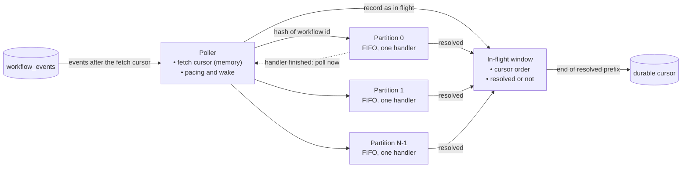

# Parallel event processing in the orchestrator

**Date:** 2026-11-09 · **Status:** implemented and benchmarked (§6); tests of §3.6 not written, completion-wake comparison not run · **Target release:** 0.11.0
**Scope:** `kruxiaflow-core` (orchestrator, events), `kruxiaflow` (CLI settings), docs. No migration.

The orchestrator processes one event at a time. Since 0.10.0 removed the poll-timer waits, that is what limits throughput and latency at high concurrency. This plan makes the orchestrator process events of different workflows concurrently, and keeps every guarantee the serial loop gives: events of one workflow are still applied one at a time in commit order, the durable cursor still never passes an unresolved event, and a crash still replays only what was not acknowledged.

## 1. The problem

### 1.1 What the measurements say

In the 2026-11-09 benchmark (`benchmarks/README.md`), at 100 concurrent workflows:

| Measure                                                         | Value   |
|-----------------------------------------------------------------|---------|
| Orchestrator reaction time (event commit to its handling), mean | 129 ms  |
| Activity round trip (scheduled to completed), mean              | 2.4 ms  |
| Orchestrated events per second                                  | ~550    |
| Reaction time at 10 concurrent workflows, mean                  | 12.5 ms |

At that rate each event takes about 1.8 ms of the orchestrator's time, the orchestrator handles them strictly one after another, and a 129 ms wait corresponds to roughly 70 events queued ahead (both figures are derived from the measurements above, not measured directly). The activities themselves are not the limit: their round trip is 2.4 ms. Against Temporal 1.32.2 this is the scenario where Kruxia Flow's margin is thinnest (1.2x) and where its median latency is the higher of the two.

### 1.2 What the serial loop guarantees

These are the properties to preserve. They come from `run_orchestrator` and `process_workflow_event` in `core/src/orchestrator/orchestrator.rs`.

| #  | Guarantee                                                                                       | Where it comes from today                                                                    |
|----|-------------------------------------------------------------------------------------------------|----------------------------------------------------------------------------------------------|
| G1 | Events of one workflow are applied one at a time, in commit order                               | One loop handles every event in cursor order                                                 |
| G2 | The durable cursor only advances through a contiguous resolved prefix; a failing event pins it  | `resolved_prefix` in the batch loop, one forward-only cursor write per batch                 |
| G3 | Each event is handled once in normal operation and at least once across a crash                 | One consumer; handlers are replay-idempotent (duplicate guards, status gates, queue UNIQUE)  |
| G4 | A failing event is retried a bounded number of times, then replaced by a failure event (poison) | `event_failures` counter, `MAX_EVENT_PROCESSING_RETRIES`, `publish_failure_for_poison_event` |
| G5 | Nothing another workflow does can interleave with one workflow's check-then-act sequences       | Incidental: there is only one handler running                                                |

Two observations make the change smaller than it looks:

- **Order across workflows is not relied on anywhere.** Each handler reads and writes one workflow's state under a transaction-scoped advisory lock on that workflow. The timeout checker already runs concurrently with the loop on the same terms.
- **G5 has nothing to protect across workflows.** The budget gate, the only check-then-act sequence that reads accumulated state, is scoped to one workflow and one activity (`get_budget_status(workflow_id, activity_key, ...)`). Handling one workflow's events serially (G1) is enough to keep it race-free. The audit in §3.4 confirms this before the work is called done.

### 1.3 What is not the goal

- Several orchestrator processes sharing the work (§2.7). The design leaves room for it; this plan builds parallelism inside one process.
- Making one workflow's own events run in parallel. They are ordered by definition.
- Reducing the per-event cost. That is separate work and multiplies with this.

## 2. The design

One poller reads events in cursor order and hands each to one of N partitions chosen by the workflow id. Each partition handles its events one at a time, in the order received. A window tracks which fetched events are resolved, and the durable cursor follows the resolved prefix.

### 2.1 Partitions keep per-workflow order (G1)

- An event goes to partition `hash(workflow_id) mod N`. The hash is stable for the life of the process; it does not need to be stable across restarts, because nothing is in a partition across a restart.
- A partition is a first-in-first-out queue with exactly one handler task. The handler calls `process_workflow_event` as the loop does today.
- All events of a workflow therefore pass through one queue in the order the poller read them, which is commit order. G1 holds exactly, not with high probability.
- The advisory lock in `process_workflow_event` stays. It is no longer what orders the orchestrator's own work, but it still serializes the handler against the timeout checker and against a second orchestrator process.
- With N = 1 the behaviour is today's. That configuration is the regression baseline.

### 2.2 Two cursors and a window (G2, G3)

- The **fetch cursor** is in memory: the cursor of the last event the poller has read. Each fetch reads events after it. At startup it is the durable cursor.
- The **durable cursor** is the stored one. It advances only to the end of the resolved prefix of the window.
- The **window** holds every fetched, not-yet-acknowledged event in cursor order with a resolved flag. When the event at the front is resolved, the front is popped up to the first unresolved event, and the durable cursor is written once for that step. The write stays forward-only.
- The window is bounded. When it holds W events the poller stops fetching until the front moves. W bounds memory, and it bounds how much a crash replays, as the batch size does today.
- Events the handler ignores (`ActivityScheduled`, `ActivityWaiting`) are marked resolved by the poller without being dispatched.
- A crash or restart resumes from the durable cursor. Events handled but not yet acknowledged are handled again; the handlers already tolerate this (it is what happens today to the handled part of an unfinished batch).

### 2.3 Failures stay inside the partition (G4)

- A failed event is retried by its partition's handler, spaced by `poll_interval_min`, up to `MAX_EVENT_PROCESSING_RETRIES`. Then the failure event is published and the event is marked resolved, as today.
- While it is being retried, its partition waits behind it: later events of the same workflow must not overtake it, and other workflows in that partition wait as they do today. Other partitions keep working.
- The unresolved event pins the durable cursor. The window can fill behind it only if the retries outlast W events of other work, in which case the poller pauses until the event resolves. This is strictly less stalling than today, where every workflow waits for every retry.
- The retry counter lives with the partition. It no longer needs the event to be read again from the database between attempts.

### 2.4 The orchestrator's own transactions and the delivery horizon

Delivery is bounded by the oldest writing transaction on the instance: an event is deliverable only when no older writing transaction is open. Today the poller never polls while one of its own handler transactions is open. With partitions it routinely will, and a handler transaction that has written (a cost record, the state save) holds back events that committed after it began writing, such as a worker's `ActivityCompleted`.

- The transaction that held the event back ends without a notification, so without a countermeasure the poller would find nothing, wait the 50 ms minimum, and deliver late. That would put a poll-timer wait back on the busy path.
- **Each handler tells the poller when it finishes an event.** The poller treats this as a wake: it polls at once. The orchestrator's own transactions are exactly the blockers it can know about, so this is exact and costs no query.
- Other blockers (another application's transaction on a shared instance) are covered as now by the pending-events check.
- A handler transaction takes its transaction id at its first write, which for most events is the state save just before commit, so the exposure per event is short. The benchmark in §5 measures whether it matters.

### 2.5 Pacing, wake and shutdown

- `ConsumerPacing` stays with the poller and keeps its meaning: progress is a non-empty fetch; the first empty fetch after progress or a wake lingers the minimum; after that the poller asks whether events are pending.
- The pending-events question must be asked about the fetch cursor, not the durable one. While handlers are busy the durable cursor trails the fetch cursor, and asking about it would report the orchestrator's own in-flight events as held back.
- When the window is full the poller waits for the front to move, not for a wake or the timer.
- On shutdown the poller stops fetching, handlers finish the event they are on and stop, the durable cursor is written through the resolved prefix, and queued events are dropped. They are read again at the next start.

### 2.6 Resources and settings

- A handler holds one connection for its transaction and briefly uses a second for work outside it (event publishes, queue inserts, budget reads). N partitions need up to 2N connections, plus the poller, the listener and the timeout checker. The defaults (pool of 100 for `serve`, 50 for `orchestrator`) cover any sensible N; startup rejects an N that the configured pool cannot serve.
- Two settings, as environment variables and CLI parameters:

| Setting                                 | Meaning                                         | Default |
|-----------------------------------------|-------------------------------------------------|---------|
| `KRUXIAFLOW_ORCHESTRATOR_PARTITIONS`    | Number of partitions (N); 1 is serial           | 4 (*)   |
| `KRUXIAFLOW_ORCHESTRATOR_MAX_IN_FLIGHT` | Window size (W): fetched, unacknowledged events | 256     |

- The startup log line reports both. The defaults are provisional: §5 chooses them from measurements.

> (*) Built with a default of 8, chosen from the measurements (§6.2, §6.4).

### 2.7 Several orchestrator processes (out of scope, kept possible)

Today two orchestrator processes share one consumer and each handles every event; the duplicate guards make that safe but it is not scaling. The same partitioning extends across processes: K consumers, each reading only workflows whose hash falls in its share and keeping its own cursor, each running its own N partitions. Nothing here prevents that. It needs a hash that is stable across processes and releases, a consumer naming scheme, and a rule for changing K (new consumers start from the lowest old cursor). It is recorded as postponed (§3.5), not designed here.

### 2.8 Costs and limits

- One long workflow chain gains nothing. A deployment dominated by a few very hot workflows stays bound by one partition.
- Hash partitioning can put two busy workflows in one partition while another idles. With many workflows this evens out; work stealing would break G1 and is not considered.
- More concurrent transactions mean more load on PostgreSQL. Past some N the database is the limit and more partitions only add contention.
- The replay after a crash grows from one batch's unfinished part to at most W events. All of it is idempotent.

## 3. What has to be built

### 3.1 `kruxiaflow-core`: events

- `EventSource` gains a way to read events after a given cursor with a limit, under the same commit-safe horizon as `poll`, and a pending-events check relative to a given cursor. The existing consumer-id forms remain for the WebSocket broadcast poller, which is unchanged.
- `PostgresEventSource` implements both on the existing `(tx, position)` index. A way to read a consumer's stored cursor is needed for startup if one is not already exposed.
- Test doubles (`SettledEventSource` and the poller mocks) forward or implement the new methods.

### 3.2 `kruxiaflow-core`: orchestrator

- **Window**: an ordered record of in-flight events with resolution, yielding the cursor to acknowledge when the front resolves. Pure data structure, unit-testable without a database.
- **Partitions**: N bounded queues with one handler task each, running `process_workflow_event`, the retry and poison policy of §2.3, and reporting each resolution to the poller.
- **Poller**: replaces the body of `run_orchestrator`. Owns the fetch cursor, the window, pacing, the wake receiver and the durable cursor writes. Fetches at most the free space in the window.
- **Completion wake** (§2.4): handler completion wakes the poller.
- **Shutdown** as in §2.5.
- `OrchestratorConfig` gains the two settings with builders and environment parsing, and the pool check of §2.6.
- `process_workflow_event` is not changed.

### 3.3 `kruxiaflow` (CLI)

- The two settings on `serve` and `orchestrator`, with the precedence the other orchestrator settings have.

### 3.4 Audit before completion

- Confirm that no handler path reads state belonging to another workflow before writing (the claim in §1.2 about G5): the budget gate, cost recording, subscriptions, and workflow completion. Record the result in §6.
- Confirm that every event type the handler acts on is replay-idempotent when replayed out of step with later events of other workflows (it is today within a batch; the window makes the replayed set larger).

### 3.5 Docs

- `docs/architecture.md`: the orchestrator's concurrency section (it currently says events are handled one at a time), the consumer-loop description, the performance figures, and a diagram of poller, partitions and window.
- `CLAUDE.md`: the EventSource and orchestrator lines if their wording changes.
- `CHANGELOG.md`, and the configuration reference for the two settings.
- `docs/post-mvp.md` does not exist yet; create it with the multi-process consumer scheme of §2.7 as its first entry.
- `benchmarks/README.md`: the result set from §5.

### 3.6 Tests

Not to be written until asked for. When they are, the ones that carry the guarantees:

| Guarantee | Test                                                                                                                        |
|-----------|-----------------------------------------------------------------------------------------------------------------------------|
| G1        | Many events for one workflow interleaved with other workflows' are applied in commit order with N > 1                       |
| G1        | Two workflows that hash to different partitions are handled concurrently (one blocked handler does not delay the other)     |
| G2        | The durable cursor does not pass an unresolved event while later events in other partitions resolve                         |
| G2, G3    | Stop the orchestrator with events handled but unacknowledged; after restart every workflow completes and none is duplicated |
| G4        | A failing event is retried the configured number of times, replaced by a failure event, and the cursor then moves past it   |
| G4        | While one event is being retried, workflows in other partitions keep progressing                                            |
| §2.2      | The window is bounded: the poller stops fetching at W and resumes when the front moves                                      |
| §2.4      | An event held back only by a handler's own transaction is delivered without waiting for the timer                           |
| §2.1      | N = 1 passes the existing orchestrator suite unchanged                                                                      |

Window behaviour is unit-tested without a database. The rest run against the local Docker PostgreSQL like the existing integration tests, and must not hold writing transactions open for long (they delay every parallel test on the instance).

## 4. Rollout

- No migration and no change to stored data. The consumer id and the cursor's meaning are unchanged, so upgrade and downgrade are a restart.
- The default changes behaviour (N = 4 as planned, 8 as built). An operator who wants the old behaviour sets `KRUXIAFLOW_ORCHESTRATOR_PARTITIONS=1`.
- Order of work: events API (§3.1), window, partitions and poller behind N = 1 with the existing suite passing, then N > 1, the completion wake, the audit, benchmark, docs.

## 5. Benchmark

Same harness and host as the 2026-11-09 results, each configuration on a fresh stack with a discarded warm-up, alternated with the 0.10.0 image in one session.

| Question                                         | Measurement                                                     | Expectation                                                                                                                         |
|--------------------------------------------------|-----------------------------------------------------------------|-------------------------------------------------------------------------------------------------------------------------------------|
| Does N = 1 cost anything?                        | Standard suite and reaction times, N = 1 against 0.10.0         | Equal within noise                                                                                                                  |
| How much does parallelism buy at 100 concurrent? | High-Concurrency-3 throughput and reaction time for N = 2, 4, 8 | Reaction time falls from ~129 ms toward the ~12 ms seen at 10 concurrent; throughput rises until PostgreSQL or the worker limits it |
| Where is the knee?                               | The same across N, with database CPU                            | Chooses the default N                                                                                                               |
| Does the completion wake matter?                 | N = 4 with and without it                                       | Without it, reaction-time tail shows 50 ms steps                                                                                    |
| Are the quiet cases unaffected?                  | Sequential-5, Parallel-10 and the idle-latency test             | Equal within noise                                                                                                                  |
| Is anything lost?                                | Completion counts and server warnings in every run              | Every workflow completes, no warnings                                                                                               |

At higher throughput the built-in worker (one activity per poll in the benchmark settings) may become the limit; if so the result is reported with that stated, and with a run that lifts it.

## 6. Implementation record

### 6.1 Status

| Part                              | Status                                                                                                |
|-----------------------------------|-------------------------------------------------------------------------------------------------------|
| §3.1 Events API                   | Done: `EventSource::poll_after`, `has_pending_events_after`, with defaults; Postgres and test wrapper |
| §3.2 Window                       | Done: `core/src/orchestrator/window.rs` (`InFlightWindow`), with two unit tests                       |
| §3.2 Partitions, poller, shutdown | Done: `run_partition`, `Poller`, `run_orchestrator` in `orchestrator.rs`                              |
| §3.2 Completion wake              | Done; its effect not measured (§6.4)                                                                  |
| §3.2 Config                       | Done: `partitions`, `max_in_flight`, environment parsing, builders                                    |
| §3.3 CLI                          | Done on `orchestrator`; `serve` takes the environment variables (it has no orchestrator flags)        |
| §3.4 Audit                        | Done (§6.3)                                                                                           |
| §3.5 Docs                         | Done: architecture, CLAUDE.md, changelog, post-mvp.md (new), benchmark README                         |
| §3.6 Tests                        | Not written (not asked for yet). The existing suite passes                                            |
| §5 Benchmark                      | Done except the completion-wake comparison (§6.4)                                                     |

### 6.2 Departures from this plan

| The plan said                                           | What was built                                                                                       | Why                                                                                                      |
|---------------------------------------------------------|------------------------------------------------------------------------------------------------------|----------------------------------------------------------------------------------------------------------|
| Default of 4 partitions (provisional)                   | Default of 8                                                                                         | Measured: throughput rises to 8 and not beyond (§6.4)                                                    |
| Startup rejects a partition count the pool cannot serve | The `orchestrator` command rejects it; the core loop runs fewer partitions and logs a warning        | `serve` and tests build the config without CLI validation; refusing to start there would be a regression |
| A way to read the stored cursor at startup              | Not needed: `poll_after` with no cursor reads from the stored one                                    | One fewer method                                                                                         |
| Handlers finish their current event on shutdown         | As planned; on an event-source error the handlers are stopped the same way and the error is returned | The serial loop returned the error at once                                                               |
| (not in the plan)                                       | The existing suite exercises one partition only                                                      | `sqlx::test` pools hold 5 connections, which serve one partition under the 2N + 2 rule                   |

The last row matters for §3.6: tests of more than one partition must build their own larger pool.

### 6.3 Audit results (§3.4)

- **No handler path reads another workflow's state.** Every query in `process_workflow_event` and the functions it calls is keyed by the event's workflow id: definition and state loads, the budget gate (`get_activity_cost(workflow, activity)`, `get_workflow_cost(workflow)`, `budget_limit_usd` of the workflow), cost records, subscriptions and queue operations. The two queries that scan across workflows are in the timeout checker, which already ran concurrently with the loop.
- **Replay.** The handlers' duplicate guards were not changed, and what they must tolerate is unchanged in kind (events handled but not acknowledged are handled again in order per workflow); the set can now be up to the window instead of one batch. This was checked by reading the guards, not by a test: the restart test of §3.6 is still owed.

### 6.4 Benchmark results against the expectations of §5

Full tables in `benchmarks/README.md`, "2026-11-09 (parallel orchestrator, unreleased)". One session on a quiet host; every workflow completed in every run with no server warnings.

| Question                                         | Expectation                                       | Result                                                                                                                              |
|--------------------------------------------------|---------------------------------------------------|-------------------------------------------------------------------------------------------------------------------------------------|
| Does N = 1 cost anything?                        | Equal within noise                                | Equal: 89.2 / 42.1 / 132.2 wf/s against 90.2 / 44.9 / 140.3 for 0.10.0                                                              |
| How much does parallelism buy at 100 concurrent? | Reaction time toward ~12 ms; throughput rises     | Reaction time 131 ms (0.10.0) → 42 (N=4) → 22 (N=8) → 10 (N=16); throughput 140 → 234 → 269 → 254 wf/s                              |
| Where is the knee?                               | Chooses the default                               | 8: throughput does not rise from 8 to 16. Database CPU was not recorded, so what limits it is not known                             |
| Does the completion wake matter?                 | Without it, 50 ms steps in the reaction-time tail | Not measured. With it, P99 reaction time at 10 concurrent is 10-17 ms, so no 50 ms steps are present                                |
| Are the quiet cases unaffected?                  | Equal within noise                                | Wrong for the suite: Sequential-5 and Parallel-10 nearly double (90 → 160, 45 → 81 wf/s). Idle single-workflow latency is unchanged |
| Is anything lost?                                | Every workflow completes, no warnings             | Yes: 1,840 of 1,840 in each of nine runs, no warnings                                                                               |

The plan's expectation for the low-concurrency scenarios was wrong: at 10 concurrent workflows the serial orchestrator was already queueing (12 ms reaction time against 3-4 ms with eight partitions).
