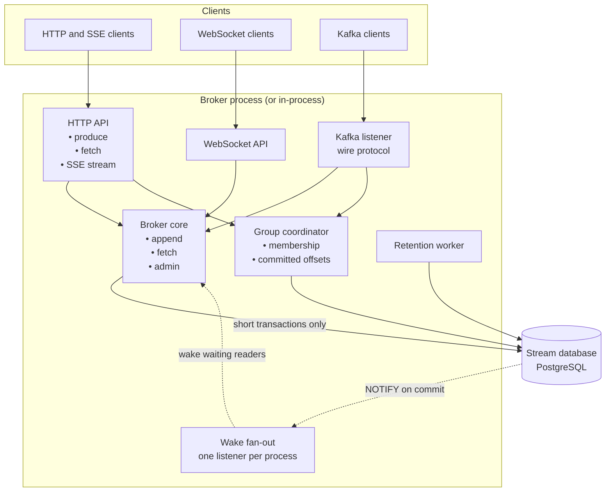
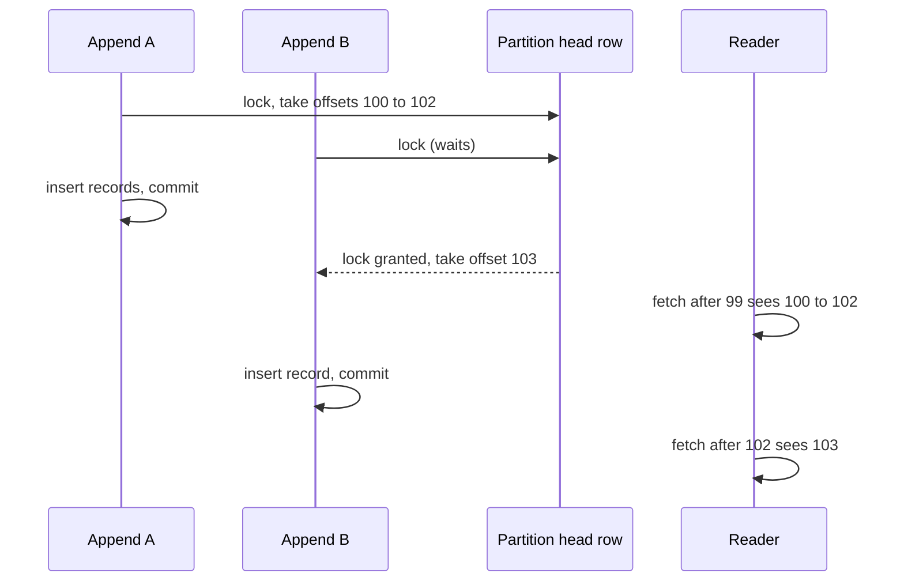

# Event streaming platform on PostgreSQL

**Date:** 2026-11-15 · **Status:** draft for review; nothing implemented, nothing measured · **Target release:** none yet
**Scope:** a new product built from the event-delivery work in `kruxiaflow-core` and `kruxiaflow-api`. Working name in this document: **the stream**. No change to Kruxia Flow is proposed until §11.

This plan describes an event streaming platform that stores its log in PostgreSQL and serves it three ways: an HTTP API with server-sent events (the primary interface), WebSocket, and the Kafka wire protocol. It records the design decisions reached in discussion, the one decision that has to be proven before anything else is built (§5), and the order of work.

Every performance figure in this document is an estimate from reading the code. None has been measured.

## 1. Decisions already made

| #  | Decision                                                                                    | Reason                                                                                                      |
| -- | ------------------------------------------------------------------------------------------- | ----------------------------------------------------------------------------------------------------------- |
| D1 | Order is per partition; each record has one 64-bit offset                                   | Kafka clients address records by a single offset per partition and expect offset order to be delivery order |
| D2 | Offsets are assigned under a per-partition lock held to commit; the xmin cursor is not used | Makes offset order equal commit order on the write side, so readers need no hold-back (§5)                  |
| D3 | The broker owns every transaction that writes to the log                                    | A caller's long transaction must never hold a partition lock or delay a reader                              |
| D4 | No publishing inside a caller's business transaction                                        | Follows from D3; Kafka clients cannot do it anyway                                                          |
| D5 | The stream has its own database and its own connection pool                                 | Keeps business transactions and stream transactions apart; with D2 a separate database is sufficient        |
| D6 | One binary can run the broker in-process or as its own process                              | Single-node deployments keep one binary; larger ones separate the broker and its PostgreSQL instance        |
| D7 | LISTEN/NOTIFY stays a wake-up only                                                          | Unchanged rule from Kruxia Flow: every consumer must be correct with it disabled                            |
| D8 | Kruxia Flow keeps its xmin log unless the gates in §11 pass                                 | The xmin design suits many concurrent single-event writers; moving is optional, not a goal                  |

## 2. Goals and non-goals

### 2.1 Goals

- Guaranteed delivery: no record can become visible behind an offset a consumer has already passed.
- Per-partition ordering, with a key that selects the partition.
- SSE and HTTP as first-class interfaces: produce, fetch, and a resumable live stream.
- Kafka wire compatibility sufficient for unmodified mainstream clients to produce, consume, and use consumer groups.
- One dependency: PostgreSQL. No ZooKeeper, no KRaft quorum, no object store.
- Configuration by environment variables and CLI parameters only.

### 2.2 Non-goals

- Kafka-scale throughput. The target is the range PostgreSQL serves well; the number is to be measured (§12), not promised.
- Log compaction, Kafka transactions, exactly-once semantics, and the idempotent producer in the first releases (§9.3).
- Multi-broker clustering in the first releases (§8.4).
- Publishing atomically with a caller's own database writes (D4). An outbox relay can be added later for callers who need it.
- Replacing Kruxia Flow's `EventSource` (D8).

## 3. What exists today and what transfers

| Part of Kruxia Flow                                       | Where                                   | Transfers as                                                  |
| --------------------------------------------------------- | --------------------------------------- | ------------------------------------------------------------- |
| NOTIFY wake, listener fan-out, reconnect counts as a wake | `core/src/events/wake.rs`               | Reused nearly unchanged; channels become per topic            |
| Drain-then-wait poll loop with adaptive backoff           | orchestrator, `api` broadcast poller    | Reused as the pattern for every reader                        |
| Durable forward-only consumer cursor                      | `postgres_event_source.rs`              | The idea carries; the cursor becomes one offset per partition |
| Replay from a client-supplied position                    | `get_events_from_id`, WebSocket handler | Becomes fetch-from-offset and SSE `Last-Event-ID`             |
| Broadcast poller and subscription manager                 | `api/src/workflow_events/`              | Pattern for the SSE and WebSocket fan-out                     |
| SSE endpoint                                              | worker wake                             | Transport experience only; it carries no event data today     |
| Partition by key hash, serial within a partition          | parallel orchestrator                   | Same idea, moved from the consumer into the log itself        |
| `(tx, position)` cursor with `tx < xmin`                  | `postgres_event_source.rs`, migrations  | **Does not transfer** (D2). The reasoning does; see §5        |
| Cluster guard and `rebase-events`                         | `core/src/events/rebase.rs`             | Not needed: no transaction ids are stored                     |

What is missing entirely: topics, partitions, keys, headers, retention, consumer groups, and a wire protocol. The existing log is one table typed to workflow events.

## 4. Architecture

- **Broker core** is a library with no protocol knowledge. The three interfaces are thin adapters over it, so a record produced through one is readable through the others.
- **Every arrow into the stream database is a transaction the broker opened and will close itself** (D3). No interface exposes a transaction handle.
- **The wake path** is the existing design: a statement-level trigger notifies on commit, one listener per process fans out to waiting readers, and every reader also polls on a timer.

## 5. Offset assignment: the decision to prove first

### 5.1 The requirement

A consumer that has read up to offset N in a partition must never later find a record at or below N that it did not see. Kruxia Flow meets the equivalent requirement on the read side with the xmin filter. The stream meets it on the write side.

### 5.2 The mechanism

- Each partition has one head row holding its next offset.
- An append takes a row lock on the head row, reads the next offset, advances it by the number of records, inserts the records, and commits. The lock is held until the commit or rollback.
- The append transaction runs at read-committed isolation, so the head row it reads after acquiring the lock is the latest committed one.

### 5.3 Why it is correct

- Offset 103 is not assigned until the transaction holding 100 to 102 has committed or rolled back. So any snapshot that can see 103 was taken after 100 to 102 were resolved, and sees them if they committed.
- A rollback restores the head row, so the offsets are reused and no gap is left by an aborted append.
- A transaction's records become visible together, so a reader never sees part of a batch.

### 5.4 What it costs

| Aspect                               | xmin cursor (Kruxia Flow today)       | Per-partition lock (the stream)          |
| ------------------------------------ | ------------------------------------- | ---------------------------------------- |
| Who waits                            | Readers                               | Writers to the same partition            |
| Effect of a long writing transaction | Delays every reader on the instance   | Cannot occur: the broker owns the writes |
| Cursor                               | `(tx, position)`, tied to one cluster | One 64-bit offset, survives dump/restore |
| Concurrent appends to one partition  | Unlimited                             | One commit at a time                     |
| Order guaranteed                     | Across the whole log                  | Within a partition only                  |

The write ceiling for a partition is about one commit at a time, so roughly the reciprocal of the commit latency, multiplied by the records per commit. The broker therefore has to batch: appends waiting for the same partition are combined into one transaction (group append). This is possible only because of D3.

### 5.5 Rules that follow

1. An append transaction touches one partition. A produce request spanning several partitions is several transactions. This removes lock-ordering deadlocks and keeps lock time minimal.
2. Offsets are increasing, not guaranteed dense. Retention removes the low end, and any future dedup or compaction may leave gaps. Nothing may assume `offset + 1` exists. (Kruxia Flow's cursor work made the opposite assumption about `position` and had to correct it.)
3. The head row is updated on every append, so its table needs fill-factor headroom and aggressive autovacuum settings.
4. Nothing but the broker core writes to the log tables. Database permissions should enforce this, not convention.

### 5.6 Proof before design freeze

The cursor plan's review recommended writing the counterexample tests before fixing the design. The same applies here. Before any interface work, these must be demonstrated against a real PostgreSQL:

- Two concurrent appends to one partition, the first committing late: a reader between the two commits never passes a record it has not seen.
- An append that rolls back: no record is lost and no reader is stranded.
- Concurrent appends to different partitions do not block one another.
- A reader running at each isolation level PostgreSQL offers gets the same guarantee.
- Group append under load: every acknowledged record is present exactly once, in offset order.

## 6. Data model

Described as requirements; column types and indexes are settled in the phase that builds each part.

| Entity           | Holds                                                                               | Notes                                                                        |
| ---------------- | ----------------------------------------------------------------------------------- | ---------------------------------------------------------------------------- |
| Topic            | Name, partition count, retention settings, creation time                            | Partition count can grow; shrinking is not supported                         |
| Partition head   | Topic, partition number, next offset, log start offset                              | The row locked by an append (§5.2)                                           |
| Record           | Topic, partition, offset, key, value, headers, producer timestamp, append timestamp | Key and value are opaque bytes; identified by topic, partition, offset       |
| Consumer group   | Group id, generation, protocol state                                                | §8                                                                           |
| Group member     | Group, member id, session deadline, subscribed topics, assignment                   | §8                                                                           |
| Committed offset | Group, topic, partition, offset, metadata, commit time                              | Forward and backward moves both allowed (a consumer may rewind deliberately) |

Open choice, to settle in Phase 1 by measurement: **one row per record, or one row per produced batch.**

| Option             | For                                                                          | Against                                                              |
| ------------------ | ---------------------------------------------------------------------------- | -------------------------------------------------------------------- |
| One row per record | Simple; fetch by offset is a range scan; SSE and HTTP serve records directly | More rows, more index, more WAL per record                           |
| One row per batch  | Much less write cost for Kafka producers, which send batches                 | Fetch must unpack; a batch can straddle the offset a reader asks for |

Recommendation: start with one row per record, measure, and add batch rows only if the write ceiling requires it.

## 7. Read path and the native API

### 7.1 Fetch

- A fetch names a topic, a partition and a starting offset, and returns records in offset order up to a limit.
- A fetch below the log start offset is an explicit out-of-range error carrying the current start offset, never a silent skip.
- A fetch that finds nothing can wait: it returns when a wake arrives and a re-fetch finds records, or when its maximum wait expires. The Kafka fetch long-poll and the SSE stream are both this.
- The wake carries no data a reader depends on. If a partition hint is added to the notification payload to avoid waking readers of other partitions, a reader must still be correct when the hint is absent or wrong.

### 7.2 HTTP

| Operation        | Requirement                                                                                                      |
| ---------------- | ---------------------------------------------------------------------------------------------------------------- |
| Produce          | One or more records to a topic; partition chosen by key hash unless given; response carries each record's offset |
| Fetch            | Records from a topic, partition and offset; optional wait                                                        |
| Stream (SSE)     | A live stream from a starting offset; resumable with `Last-Event-ID`                                             |
| Offsets          | Earliest and latest offset per partition; offset for a timestamp                                                 |
| Group operations | Commit and read a group's offsets, so an HTTP consumer can resume without storing offsets itself                 |
| Admin            | Create, describe, alter and delete topics                                                                        |

SSE requirements:

- The event id must be enough to resume. For a single-partition stream it is the offset. For a stream over several partitions it must encode an offset per partition, since there is no order across partitions.
- A slow client must not hold memory in the broker without bound. The stream reads from the database at the client's pace; it does not buffer the topic.
- Heartbeat comments keep idle connections open through proxies.

### 7.3 WebSocket

Second in priority. Same semantics as SSE, with the addition that the client can change its subscriptions and acknowledge offsets on the same connection. Built after SSE, on the same fan-out.

### 7.4 Authentication

The JWT provider pattern from Kruxia Flow is reused for HTTP, SSE and WebSocket. Authorization is per topic and per operation (produce, consume, admin). The Kafka listener's authentication is in §9.4.

## 8. Consumer groups

### 8.1 Requirements

- Members of a group divide a topic's partitions among themselves; each partition is read by at most one member of the group at a time.
- A member that stops heartbeating loses its partitions after a session timeout, and they are reassigned.
- Committed offsets survive broker restarts and member changes.
- A commit from a member of a superseded generation is rejected, so a member that was presumed dead cannot overwrite a newer owner's progress.

### 8.2 Relationship to Kafka's protocol

In Kafka's classic group protocol the broker coordinates membership and generations, but one member (the group leader) computes the assignment and the broker distributes it. The coordinator therefore needs membership, generation and heartbeat handling, and does not need its own assignment strategies for Kafka clients. HTTP and SSE consumers have no such leader, so the broker needs one built-in assignment strategy for them.

### 8.3 State

Group state is stored in PostgreSQL, not only in memory, so a broker restart does not force every group to rebuild from nothing and so a later multi-broker design (§8.4) has somewhere to start.

### 8.4 One broker first

The first releases run one broker process. It advertises itself as the leader of every partition and the coordinator of every group. Several broker processes over one database is a later design: the append path already tolerates it (the partition lock is in the database), but group coordination, the advertised metadata and connection routing do not.

## 9. Kafka wire protocol

### 9.1 Approach

- A separate TCP listener speaks the Kafka protocol and translates to broker core and group coordinator calls.
- Protocol encoding and decoding should come from an existing Rust crate, not be written by hand. Candidates are to be evaluated in Phase 4, including for licence compatibility.
- The listener sits behind a build feature so that a build without it stays small.

### 9.2 First set of APIs

| Area      | APIs                                                         | Purpose                                     |
| --------- | ------------------------------------------------------------ | ------------------------------------------- |
| Handshake | ApiVersions, Metadata                                        | Every client starts here                    |
| Produce   | Produce                                                      | Append                                      |
| Consume   | Fetch, ListOffsets                                           | Read and find the earliest or latest offset |
| Groups    | FindCoordinator, JoinGroup, SyncGroup, Heartbeat, LeaveGroup | Group membership                            |
| Offsets   | OffsetCommit, OffsetFetch                                    | Group progress                              |
| Admin     | CreateTopics, DeleteTopics, DescribeConfigs (minimal)        | What common tools call on startup           |

### 9.3 Deferred

- Idempotent producer and transactions. Note that recent Java clients enable idempotence by default; the behaviour when the broker does not advertise it has to be tested, and it may force InitProducerId into the first set.
- The newer consumer group protocol, compaction, quotas, ACL APIs, and SASL mechanisms beyond the first.

### 9.4 Semantics to map

| Kafka concept         | In the stream                                                                                         |
| --------------------- | ----------------------------------------------------------------------------------------------------- |
| Acknowledgement level | Every acknowledged produce is committed to PostgreSQL. A request for no acknowledgement still commits |
| Record batch          | Unpacked into records (or stored whole, per §6); compressed batches are decompressed by the broker    |
| High watermark        | The partition's next offset; there is no replication lag to account for                               |
| Leader and replicas   | One broker is leader for everything; durability and replication are PostgreSQL's                      |
| Advertised listener   | Configured explicitly, since clients reconnect to the address the metadata gives them                 |
| Authentication        | SASL/PLAIN over TLS first, checked against the same credentials as the HTTP API                       |

### 9.5 Compatibility testing

A matrix of real clients run against the listener: librdkafka, the Java client, franz-go, and a Python client, each for produce, consume, group join, rebalance, and offset commit. A client is listed as supported only when its row passes.

## 10. Retention and operations

- **Retention** is by age and by size, per topic. The record table is range-partitioned so that expiring data is dropping a table partition, not deleting rows. The log start offset in the partition head moves forward when data is dropped.
- **Health**: database reachability, listener state, and per-partition append lag for the group append queue.
- **Metrics**: append rate and latency, fetch rate and latency, wake counts, consumer group lag (latest offset minus committed offset), open streams.
- **Configuration**: environment variables and CLI parameters only, with CLI taking precedence. The prefix is chosen with the product name.

### 10.1 Deployment modes

| Mode       | Broker                 | Database                                     | For                                    |
| ---------- | ---------------------- | -------------------------------------------- | -------------------------------------- |
| Embedded   | Inside the host binary | Own database in the same PostgreSQL instance | Single node, small devices             |
| Standalone | Its own process        | Own database, same or separate instance      | Isolation of load, independent scaling |

In both modes the stream uses its own connection pool and never shares a transaction with anything else (D3, D5). Sharing an instance still shares disk, WAL, connection limits and vacuum; that affects speed, not delivery.

## 11. Kruxia Flow on the stream (optional, gated)

Not part of the product's path to release. Recorded here so that the decision is made on evidence.

### 11.1 What would change

- Workflow events become one topic, partitioned by workflow id. The orchestrator's in-process partitions map onto topic partitions, each with its own cursor; the in-flight window, the held-back re-poll and `rebase-events` are no longer needed.
- Several orchestrator processes could divide the work through a consumer group, which is the item currently in `docs/post-mvp.md`.
- **Workflow submission** is the one place found that writes a business row and an event in one transaction. With events in another database that atomicity is lost and must be replaced: publish first with an idempotency key and let the consumer create the row, or keep a small outbox for that write. The other publish sites (orchestrator, worker service, signals) are already standalone statements with replay-idempotent handlers.
- **Deduplication.** Kruxia Flow relies on a unique index over workflow, event type, activity, iteration and attempt. The stream would need an optional idempotency key per record, or Kruxia Flow keeps that check on its own side.
- **Queries.** Kruxia Flow reads its events as an ordinary table (history, dashboard, health). Opaque records do not serve that; Kruxia Flow would keep a projection of its own.

### 11.2 Expected effect (estimates)

| Measure       | Expectation                                                                            |
| ------------- | -------------------------------------------------------------------------------------- |
| Publish cost  | Higher per event: a head-row lock and update, and a call to the broker                 |
| Write ceiling | Lower per partition; ample on SSDs with group append, uncertain on SD-card storage     |
| Read cost     | Slightly lower: no snapshot check, no held-back re-polls                               |
| Idle latency  | Unchanged; the wake path is the same                                                   |
| CPU           | A few percent either way                                                               |
| Memory        | Small when embedded; a second pool of connections either way                           |
| Throughput    | No gain expected. The benefits are multi-process orchestration and cluster portability |

### 11.3 Gates

Kruxia Flow moves only if all of these hold, on the same benchmark suite used for releases:

1. Throughput and latency at every scenario are not worse than the release before.
2. The same holds on the Raspberry Pi targets.
3. Memory at rest does not grow beyond an agreed budget.
4. Submission atomicity is replaced by a design with tests showing no workflow can exist without its created event.

If a gate fails, Kruxia Flow keeps the xmin log and shares only the wake and poll-loop code with the stream.

## 12. Measurement plan

Numbers this document needs and does not have:

| Question                                                     | Measured in |
| ------------------------------------------------------------ | ----------- |
| Appends per second per partition, single-record commits      | Phase 1     |
| The same with group append, at several batch sizes           | Phase 1     |
| Both of the above on SD-card storage                         | Phase 1     |
| Row-per-record against row-per-batch                         | Phase 1     |
| Cost of NOTIFY at high commit rates                          | Phase 1     |
| End-to-end latency, produce to SSE delivery, idle and loaded | Phase 2     |
| Memory per open SSE stream and per Kafka connection          | Phase 2, 4  |
| Consumer group rebalance time                                | Phase 3     |

The NOTIFY row is there because PostgreSQL serializes part of the commit of transactions that notify. Kruxia Flow already pays this; at the stream's intended rates it has to be measured, and a wake that is throttled or sent by the broker itself is the fallback.

## 13. Phases

| Phase | Builds                                                                                  | Done when                                                                                  |
| ----- | --------------------------------------------------------------------------------------- | ------------------------------------------------------------------------------------------ |
| 0     | Positioning, name, repository and licence; review of existing PostgreSQL-backed brokers | A written statement of what this product does that the alternatives do not                 |
| 1     | Log store and broker core: topics, partitions, append with group append, fetch, wake    | §5.6 demonstrated; §12 Phase 1 numbers recorded; record storage choice made                |
| 2     | HTTP API and SSE; authentication; admin                                                 | Produce, fetch and a resumable stream work end to end; reconnect loses and repeats nothing |
| 3     | Consumer groups and committed offsets; group operations over HTTP                       | Members divide partitions; a dead member's partitions move; stale commits are rejected     |
| 4     | Kafka listener, first API set                                                           | The compatibility matrix (§9.5) passes for at least two clients                            |
| 5     | Retention; metrics; health; standalone and embedded modes                               | Data expires by dropping partitions; both modes documented and run in CI                   |
| 6     | WebSocket                                                                               | Parity with SSE plus in-connection subscription changes                                    |
| 7     | Kruxia Flow evaluation (§11)                                                            | The gates in §11.3 are run and the result recorded, whichever way it goes                  |

Phase 1 can be built as a crate inside this workspace so that it reuses the wake code and the test infrastructure directly. Whether it later moves to its own repository is a Phase 0 decision.

## 14. Risks and open questions

| #  | Item                                                                                                                                                   | Resolved by                            |
| -- | ------------------------------------------------------------------------------------------------------------------------------------------------------ | -------------------------------------- |
| R1 | Write ceiling on slow storage is too low even with group append                                                                                        | Phase 1 measurement                    |
| R2 | An existing project already covers this ground (Tansu is believed to be a Rust Kafka-compatible broker with a PostgreSQL storage engine; not verified) | Phase 0 review                         |
| R3 | Mainstream Kafka clients need more of the protocol than §9.2 to work with default settings                                                             | Phase 4 compatibility matrix           |
| R4 | The head-row update pattern bloats under sustained load                                                                                                | Phase 1 soak test with vacuum settings |
| R5 | A multi-partition SSE stream needs an event id format that stays small as partition counts grow                                                        | Phase 2 design                         |
| R6 | One broker is a single point of failure; PostgreSQL failover does not move client connections                                                          | Stated limitation at first; §8.4 later |
| R7 | NOTIFY cost at high commit rates                                                                                                                       | Phase 1 measurement                    |
| Q1 | Product name and configuration prefix                                                                                                                  | Phase 0                                |
| Q2 | Same repository and licence as Kruxia Flow, or separate                                                                                                | Phase 0                                |
| Q3 | Whether the stream offers an idempotency key per record (needed by §11, useful generally)                                                              | Phase 1 design                         |
| Q4 | Whether an outbox relay for callers who want atomic publish is in scope at all                                                                         | After Phase 5                          |
