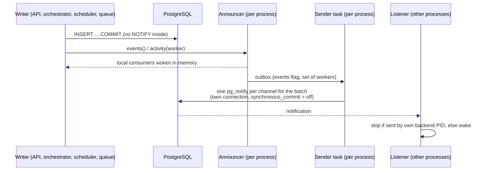

# Commit notifications from the application, and the first heartbeat

**Date:** 2026-11-23 · **Status:** implemented and benchmarked; existing wake tests adapted, no new tests written · **Target release:** 0.12.6
**Scope:** `kruxiaflow-core` (events, queue, workflow service, scheduler), `kruxiaflow` (commands, MCP), `kruxiaflow-worker-sdk` (heartbeat), migration `20261123000001`, docs.

Two changes that make the orchestrator react faster under load. Writers no longer send `NOTIFY` from inside their transactions: each process announces its own committed writes, and the triggers that notified are gone. And the Rust worker no longer sends a heartbeat the moment an activity starts. Against 0.12.5, the orchestrator's reaction under the High-Concurrency load falls from about 30 ms to 3 ms, and throughput rises by 15–20% on the concurrent workloads (§4). Delivery guarantees are unchanged: the wake is still only a hint, and every consumer still polls from its durable cursor.

## 1. The problem

### 1.1 Where the time went

Since 0.11.1, which stopped the API and orchestrator sharing one wake router, the wait under load moved from the workers' pickup to the orchestrator. On 0.12.4 and 0.12.5, with the default 8 partitions, a committed event waited 17–25 ms on average before the orchestrator began to handle it. More partitions (16, 32) changed nothing; fewer (2) made it worse. The orchestrator was not short of handlers; its events were late.

### 1.2 The NOTIFY lock

Two statement triggers (`workflow_events_notify`, `activity_queue_notify`, migrations `20261108000002` and `20261108000004`) sent a `NOTIFY` from inside every transaction that wrote an event or a claimable activity. PostgreSQL makes the commits of notifying transactions take turns on one database-wide lock (an object lock on database 0, held through each commit's WAL flush), so under load those commits queued behind one another, and so did the events they carried.

Sampling `pg_locks` during a 3,000-workflow High-Concurrency run showed it directly:

| Configuration (0.12.5)                 | Commits waiting for the lock            | Orchestrator wait |
|----------------------------------------|-----------------------------------------|-------------------|
| As released                            | avg 6.2, max 38; held in 95% of samples | 17–25 ms          |
| Triggers dropped by hand               | 0                                       | —                 |
| `synchronous_commit = off` (diagnosis) | —                                       | 7.6 ms            |

Turning off synchronous commit shortened each turn on the lock, which confirmed the mechanism, but it is not a fix: it gives up durability for every write.

### 1.3 The first heartbeat

The Rust worker's heartbeat loop used `tokio::time::interval`, whose first tick is immediate. Every activity with a timeout over 60 s therefore sent a heartbeat request as soon as it started, and the API wrote a queue update for it, most of them arriving after a short activity had already finished. That was one more notifying write per activity, and one more turn on the lock.

## 2. The design

### 2.1 Announcing after commit

- **Who announces.** `PostgresEventSource::publish` (only when the insert added a row), `WorkflowService::submit`, `PostgresQueue::schedule`, `fail` (when it retries) and `reclaim_stale_activities`, each after its transaction commits. A write that rolls back announces nothing, and a duplicate publish no longer wakes anyone.
- **Local consumers** in the same process are woken in memory through the existing watch counters, without a round trip to the database.
- **Other processes** are reached by one sender task per process. It takes everything announced since its last send (whether any events were written, and the set of workers with new activities) and sends it as a single statement, `SELECT count(*) FROM (SELECT pg_notify(c, p) FROM unnest($1, $2)) s`, on a dedicated connection (`application_name = kruxiaflow-announcer`, `synchronous_commit = off`). Only one send is in flight at a time; announcements made meanwhile wait for the next batch.
- **The sender's own commit no longer delays anyone's data.** It still takes the NOTIFY lock, but it carries no rows, does not wait for its WAL flush, and no writer waits for it.
- **The listener ignores its own process's notifications**, by comparing the notification's backend PID with the sender's, since those consumers were already woken in memory.
- **On failure** the sender keeps the batch, backs off from 100 ms to 5 s and retries; consumers meanwhile find the rows on their poll timers. **On shutdown**, when the last handle drops, it sends what is left before it exits.

### 2.2 What does not change

- The poll from the durable `(tx, position)` cursor is still the only data path; every consumer is still correct with the wake disabled (`KRUXIAFLOW_EVENT_WAKE=poll`).
- The channels (`workflow_events`, `activity_queue`) and payloads (empty, the worker name) are the same, so processes of earlier versions are still woken by new ones.

### 2.3 Costs and limits

- **Writes by anything but the application wake nobody.** A search of this repository and its sibling projects found no other writer of `workflow_events` or `activity_queue`. Hand-written SQL, or a process of an earlier version during a rolling upgrade, writes rows that consumers find on their poll timers (up to 5 s idle).
- **One more connection** per `serve`, `api` and `orchestrator` process, outside its pool, next to its LISTEN connection. `serve`'s default pool of 100 already exceeded PostgreSQL's default `max_connections` of 100: in a two-client benchmark run the last connections were refused (`sorry, too many clients already`) and a submission failed with a pool timeout. 0.12.5 has the same gap, one connection smaller. Pools need sizing so that their sum plus two per such process stays below `max_connections`.
- **Coalescing is modest at this load**: about 1.2 announcements per send in the statement-count run (§4.5). The gain comes from taking the NOTIFY out of the writers' commits, not from merging notifications.

## 3. What was built

| Part                               | Change                                                                                                                              |
|------------------------------------|-------------------------------------------------------------------------------------------------------------------------------------|
| `core/src/events/wake.rs`          | `Announcer`, `NotificationSink` and `PgNotifySink`, the outbox, the sender task, own-PID filtering in the listener, flush on drop   |
| `core/src/events/mod.rs`, `lib.rs` | `EventSource::announcer()` (default `Announcer::none()`); `Announcer` exported                                                      |
| `PostgresEventSource`              | announces each publish that inserted a row; `with_announcer`                                                                        |
| `PostgresQueue`                    | announces `schedule`, retried `fail` and reclaimed activities by worker; `with_announcer`                                           |
| `WorkflowService`, `run_scheduler` | announce submitted workflows; `with_announcer`, scheduler takes an announcer                                                        |
| `kruxiaflow` commands, API, MCP    | `serve`, `api` and `orchestrator` create the event source first and hand its announcer to the queue, the API, the scheduler and MCP |
| `worker-sdk/src/poller.rs`         | first heartbeat one interval after the claim (`interval_at`)                                                                        |
| Migration `20261123000001`         | drops both triggers and their functions; the down migration recreates them                                                          |
| Tests                              | the event, activity, API and worker wake tests now announce through the application, and check that SQL alone does not wake         |
| Docs                               | `architecture.md`, `CLAUDE.md`, superseded notes on the 2026-11-08 plans, `CHANGELOG.md`                                            |

The full workspace suite (2,399 tests), the MCP suite, `cargo fmt` and `cargo clippy --workspace --all-targets -- -D warnings` pass.

## 4. Benchmark

### 4.1 Setup

One Apple M4 Pro host (14 cores, 48 GB), Docker with 8 CPUs, PostgreSQL 18, a fresh stack per run. Three builds:

- **0.12.5**: `kruxia/kruxiaflow:0.12.5`.
- **Heartbeat only**: 0.12.5 plus the heartbeat fix.
- **Branch**: both changes.

The workloads are those of `benchmarks/`: Sequential-5 (five activities in a row), Parallel-10 (ten at once) and High-Concurrency-3 (three in a row, 100 workflows in flight). Throughput is the median of three passes; each configuration ran twice, and both results are shown. Per-step timings come from event and queue timestamps in the database. The serve pool was capped at 90 connections for the multi-client runs (§2.3).

### 4.2 Standard suite, one `serve` process

Workflows per second, two rounds:

| Test                                  | 0.12.5       | Heartbeat only | Branch       |
|---------------------------------------|--------------|----------------|--------------|
| Sequential-5                          | 165.2, 161.1 | 164.2, 168.0   | 169.6, 167.7 |
| Parallel-10                           | 81.7, 80.9   | 87.8, 88.3     | 97.3, 97.5   |
| High-Concurrency-3                    | 293.9, 299.7 | 316.2, 316.6   | 340.7, 353.4 |
| High-Concurrency-3 latency, p50 (ms)  | 319.5, 313.7 | 254.7, 260.9   | 241.7, 220.6 |
| HC orchestrator reaction, mean (ms)   | 30.3, 28.0   | 14.2, 15.4     | 2.9, 3.3     |
| HC activity round trip, mean (ms)     | 10.2, 7.8    | 3.9, 2.6       | 14.0, 20.2   |
| One workflow alone, 1 activity (ms)   | 23.8, 25.5   | 24.9, 25.9     | 25.8, 24.1   |
| One workflow alone, 5 activities (ms) | 38.8, 37.1   | 36.4, 38.9     | 40.0, 34.7   |

- **The heartbeat fix alone halves the orchestrator's reaction** and adds about 7–8% throughput on the concurrent tests. **The branch takes the reaction to 3 ms**, and Parallel-10 gains 20% and High-Concurrency-3 about 16% over 0.12.5.
- **The activity round trip rises on the branch.** The orchestrator now hands out work faster than the worker's slots take it, so activities wait in the queue for a slot. That is queueing at the workers, not a late wake; throughput still rises.
- **Sequential-5 and a lone workflow's latency do not change** beyond run-to-run noise.

### 4.3 API, orchestrator and worker as separate processes

| Test                                | 0.12.5 | Branch |
|-------------------------------------|--------|--------|
| Sequential-5 (wf/s)                 | 160.4  | 167.2  |
| Parallel-10 (wf/s)                  | 80.7   | 97.3   |
| High-Concurrency-3 (wf/s)           | 285.7  | 340.0  |
| HC orchestrator reaction, mean (ms) | 32.3   | 3.3    |
| One workflow alone, 1 activity (ms) | 23.9   | 25.7   |

The same picture as one process: wakes between processes go through the announcer's notifications at full speed.

### 4.4 One client, then several, 3,000 workflows each

High-Concurrency-3 workload. Throughput is measured by the server, from the first submission to the last completion. Every run completed every workflow.

| Clients | Measure                                        | 0.12.5             | Heartbeat only    | Branch        |
|---------|------------------------------------------------|--------------------|-------------------|---------------|
| 1       | Workflows per second                           | 343.2, 320.6       | 334.9, 331.3      | 357.1¹, 402.8 |
| 1       | Commits waiting for the lock, avg (max)        | 3.2 (10), 2.2 (10) | 3.0 (19), 0.9 (4) | 0 (0), 0 (0)  |
| 1       | Workflow start to finish, mean (ms)            | 101.6, 116.6       | 86.1, 68.1        | 67.8          |
| 1       | Completion event to its handler, mean (ms)     | 15.5, 15.1         | 13.8, 11.4        | 2.1           |
| 2       | Workflows per second                           | 294.4, 301.3       | —                 | 335.4, 321.6  |
| 2       | Commits waiting for the lock, avg (max)        | 2.5 (9), 3.6 (11)  | —                 | 0 (0), 0 (0)  |
| 2       | Orchestrator, event to queue insert, mean (ms) | 12.2, 12.0         | —                 | 3.1, 3.3      |
| 3       | Workflows per second                           | 231.0, 231.4       | —                 | 259.5, 243.0  |
| 3       | Commits waiting for the lock, avg (max)        | 1.9 (9), 2.0 (9)   | —                 | 0 (0), 0 (0)  |
| 3       | Orchestrator, event to queue insert, mean (ms) | 9.1, 7.9           | —                 | 4.0, 4.2      |

¹ The client's figure; that run's database-side figures were not saved.

- **No commit waited for the NOTIFY lock on the branch** in any sample of any run.
- **With several clients the branch is 5–14% faster.** Three clients get less in total than two because the host runs out of CPU: the Python clients alone use about 290% of the 8 CPUs.
- **One client was not the ceiling it seemed.** It had looked limited to about 330 workflows per second; on the branch the same client reaches 357–399, so part of that limit was the server.
- **Most of each workflow's time is now spent waiting for a worker slot**: 150–370 ms per step with two or three clients against 16 slots, on every build.

### 4.5 Statement counts

One pass of the suite (450 workflows; the same 4,900 events and 2,000 scheduled activities in each build), from `pg_stat_statements`:

| Build          | `pg_notify` calls                                  | All statements |
|----------------|----------------------------------------------------|----------------|
| 0.12.5         | 6,900, inside the writing transactions             | 58,963         |
| Heartbeat only | 6,900, inside the writing transactions             | 55,885         |
| Branch         | 5,673 batched sends, on the announcer's connection | 52,661         |

The suite's activities do not run long enough to show the heartbeat fix in these counts; its effect shows in §4.2.

## 5. Follow-ups

- **Worker slots are now the limit** under heavy load (§4.4); worker concurrency and the queue claim are the next things to measure.
- **`serve`'s default pool** (100) exceeds PostgreSQL's default `max_connections` (100) once the LISTEN and announcer connections are added. Lowering the default, or checking it against the server's `max_connections` at startup, would turn a pool timeout under load into a clear error at start.
- **No tests were written for the new behaviour** beyond adapting the existing wake tests, which also exercise the flush on drop: the sender's retry with backoff after a failed send is untested.
