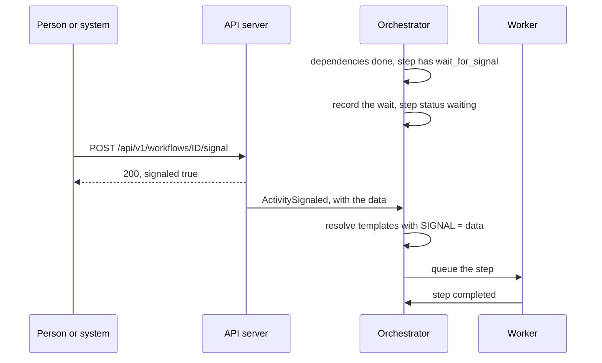
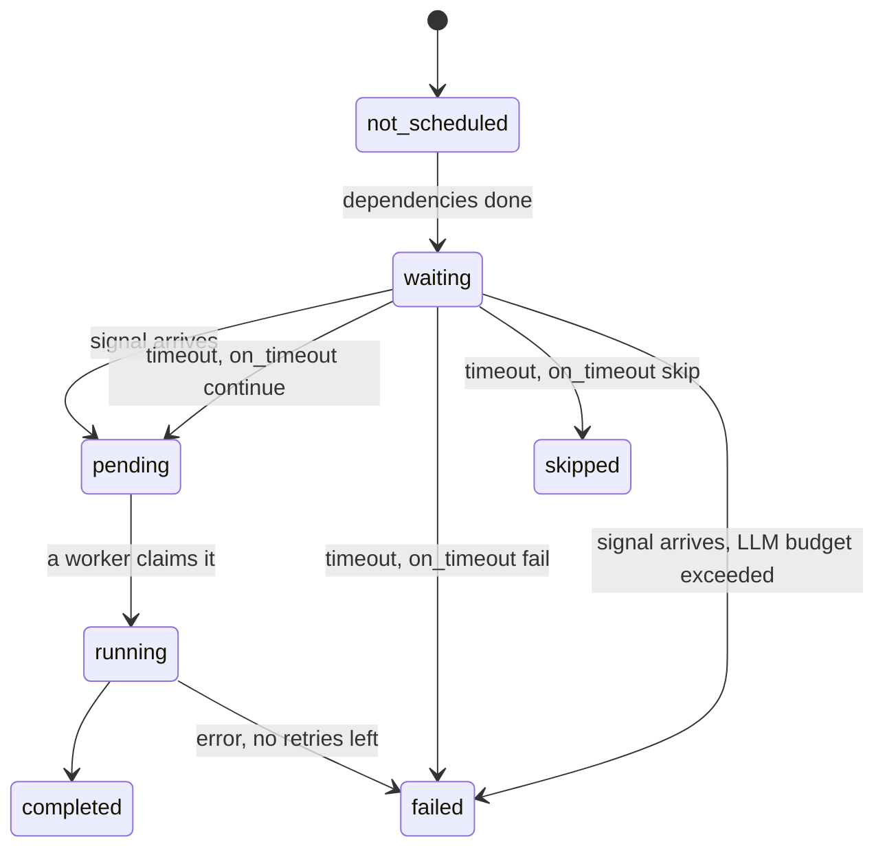

# Signals: Human-in-the-Loop Waits

A step with `settings.wait_for_signal` stops before it runs and waits for a
**signal**: an HTTP request sent by a person who approves something, or by
another system. The signal can carry data, which the step reads as
`{{SIGNAL}}`. If no signal arrives in time, the step fails, is skipped, or
runs anyway, as you choose.

> **Which version this describes.** This page describes v0.12.5. In v0.12.4
> and earlier:
>
> - `SIGNAL` is never set, and a step that uses `{{SIGNAL.*}}` fails before
>   it can wait ([#37](https://github.com/kruxia/kruxiaflow/issues/37)).
> - `{{ACTIVITY.*}}`, used in the loop example below, is never set
>   ([#32](https://github.com/kruxia/kruxiaflow/issues/32)).
> - In a loop, `delay` and `scheduled_for` apply only to a step's first
>   round.
>
> Before v0.12.2, every `wait_for_signal` step failed with "Subscription
> already exists" as soon as it was signaled
> ([#29](https://github.com/kruxia/kruxiaflow/issues/29)). `hold_early` is new
> in v0.12.4.

---

## Table of Contents

1. [How It Works](#how-it-works)
2. [A First Example](#a-first-example)
3. [The wait_for_signal Setting](#the-wait_for_signal-setting)
4. [While a Step Waits](#while-a-step-waits)
5. [Sending a Signal](#sending-a-signal)
6. [Using the Signal's Data](#using-the-signals-data)
7. [Timeouts](#timeouts)
8. [Waits Inside Loops](#waits-inside-loops)
9. [Known Limits](#known-limits)

---

## How It Works

When all of a waiting step's dependencies are done, the orchestrator does not
queue it. It records the wait and sets the step's status to `waiting`. A
signal for that step and event name ends the wait: the orchestrator resolves
the step's templates, with `SIGNAL` set to the signal's data, and queues it
like any other step.



The step's status over its life:



---

## A First Example

The examples on this page use a local server started with
`kruxiaflow serve --insecure-dev` (or the [Quick Start](quickstart.md)'s
`KRUXIAFLOW_INSECURE_DEV=true docker compose up -d`), so they send no token.
Against a server with authentication, add `-H "Authorization: Bearer $TOKEN"`
to each request (see [Authentication](api-reference.md#authentication)).

This workflow prepares a request, waits for someone to approve it, then
records the decision. Each step uses the std worker's `echo` activity, which
returns its parameters as an output named `echo`. Save it as
`budget_approval.yaml`:

```yaml
name: budget_approval
activities:
  - key: prepare
    worker: std
    activity_name: echo
    parameters:
      request: "Approve the Q3 budget of {{INPUT.amount}}?"

  - key: await_approval
    worker: std
    activity_name: echo
    depends_on: [prepare]
    parameters:
      approved: "{{SIGNAL.approved}}"
      approver: "{{SIGNAL.approver}}"
    settings:
      wait_for_signal:
        event_name: approval
        timeout_seconds: 259200   # three days

  - key: record
    worker: std
    activity_name: echo
    depends_on: [await_approval]
    parameters:
      decision: "{{await_approval.echo.approved}}"
      by: "{{await_approval.echo.approver}}"
```

Deploy it and start a run:

```bash
curl -s -X POST http://localhost:8080/api/v1/workflow_definitions \
  -H "Content-Type: text/yaml" --data-binary @budget_approval.yaml; echo

WORKFLOW_ID=$(curl -s -X POST http://localhost:8080/api/v1/workflows \
  -H "Content-Type: application/json" \
  -d '{"definition_name": "budget_approval", "input": {"amount": 50000}}' \
  | jq -r .workflow_id); echo $WORKFLOW_ID
```

`await_approval` is now waiting, and the workflow is running:

```bash
curl -s http://localhost:8080/api/v1/workflows/$WORKFLOW_ID | \
  jq -c '.status, [.activities[] | {activity_key, status}]'
```

```text
"running"
[{"activity_key":"await_approval","status":"waiting"},{"activity_key":"prepare","status":"completed"},{"activity_key":"record","status":"not_scheduled"}]
```

Approve it:

```bash
curl -s -X POST http://localhost:8080/api/v1/workflows/$WORKFLOW_ID/signal \
  -H "Content-Type: application/json" \
  -d '{"activity_key": "await_approval", "event_name": "approval",
       "data": {"approved": true, "approver": "dana@example.com"}}'
```

```json
{"signaled":true,"held":false,"message":"Activity signaled successfully"}
```

`await_approval` runs with the signal's data, then `record` reads it from
`await_approval`'s output, and the workflow completes:

```bash
curl -s http://localhost:8080/api/v1/workflows/$WORKFLOW_ID | \
  jq -c '.status, (.activities[] | select(.activity_key == "record") | .outputs[0].value)'
```

```text
"completed"
{"by":"dana@example.com","decision":true}
```

---

## The wait_for_signal Setting

`wait_for_signal` goes under the step's `settings`. It is an object with these
fields:

| Field             | Required | Meaning                                                                                                                                                            |
|-------------------|----------|--------------------------------------------------------------------------------------------------------------------------------------------------------------------|
| `event_name`      | yes      | The name a signal must carry. A signal with another name doesn't end the wait.                                                                                     |
| `timeout_seconds` | yes      | How long to wait, in seconds, counted from when the step starts waiting.                                                                                           |
| `on_timeout`      | no       | What happens when the time runs out: `fail` (the default), `skip` or `continue`.                                                                                   |
| `hold_early`      | no       | `true` keeps a signal that arrives while the step isn't waiting, for its next wait (see [Signals that arrive early](#signals-that-arrive-early)). Default `false`. |

| `on_timeout`     | The step                                                                     | The workflow                                    |
|------------------|------------------------------------------------------------------------------|-------------------------------------------------|
| `fail` (default) | `failed`, with the error `Signal '<event_name>' not received before timeout` | fails, with the same `error_message`            |
| `skip`           | `skipped`, without running                                                   | carries on, and completes if nothing else fails |
| `continue`       | runs, with `{{SIGNAL}}` set to `null`                                        | carries on                                      |

The step starts waiting when it would otherwise be queued: when its
dependencies are done, or as soon as the workflow starts if it has none.

Mistakes in the setting are refused when the workflow is deployed, with a
`422 VALIDATION_ERROR`:

| Mistake                                | Error (in `error.details.field_errors.definition`)                       |
|----------------------------------------|--------------------------------------------------------------------------|
| `wait_for_signal: approval` (a string) | `invalid type: string "approval", expected struct WaitForSignalSettings` |
| `timeout_seconds` missing              | ``missing field `timeout_seconds` ``                                     |
| An unknown `on_timeout`                | ``unknown variant `retry`, expected one of `continue`, `skip`, `fail` `` |

---

## While a Step Waits

- The step's status is `waiting` and the workflow's is `running`. The step's
  `started_at` is when the wait began.
- Nothing is queued: no worker is busy, and nothing is spent. A budget check
  for the step happens when the wait ends, not when it begins.
- The wait is a row in PostgreSQL, so it survives restarts. Stop and start
  `kruxiaflow serve`, send the signal, and the workflow carries on. A timeout
  that passes while the server is down takes effect once it is back.
- A workflow-level `settings.timeout`, if the definition sets one, still
  applies while a step waits.

### Finding waiting workflows

The REST API has no filter for waiting steps. `GET /api/v1/workflows?status=running`
lists running workflows (waiting ones among them), and
`GET /api/v1/workflows/:workflow_id` shows each step's status:

```bash
curl -s http://localhost:8080/api/v1/workflows/$WORKFLOW_ID | \
  jq -c '[.activities[] | select(.status == "waiting") | .activity_key]'
```

The [MCP server](mcp-server.md) has a tool for it: `list_waiting_workflows`
lists the running workflows that have a step waiting for a signal, optionally
only those waiting for one `signal_name` (an `event_name`), with `limit`
(default 20) and `offset`. `limit`, `offset` and `total` count waiting steps,
not workflows: a page of `limit` steps is grouped by workflow, so it can hold
fewer workflows than `limit`. For example, `list_waiting_workflows {"signal_name": "approval"}`
returns:

```json
{
  "limit": 20,
  "offset": 0,
  "total": 1,
  "workflows": [
    {
      "definition_name": "budget_approval",
      "waiting_activities": [
        {
          "activity_key": "await_approval",
          "signal_name": "approval",
          "waiting_since": "2026-11-20T02:25:02.674208+00:00"
        }
      ],
      "workflow_id": "01a1f6c5-86bf-7cd0-8d7b-00b61882af0a"
    }
  ]
}
```

---

## Sending a Signal

```http
POST /api/v1/workflows/:workflow_id/signal
Content-Type: application/json
```

| Field          | Required | Meaning                                                                                              |
|----------------|----------|------------------------------------------------------------------------------------------------------|
| `activity_key` | yes      | The key of the waiting step.                                                                         |
| `event_name`   | yes      | Must equal the step's `wait_for_signal.event_name`.                                                  |
| `data`         | no       | Any JSON value: an object, an array, a string, a number, a boolean. Omitted or `null` means no data. |

The body must be sent as JSON: `curl -d` alone sends a form body, which the
endpoint refuses. The full reference is in the
[API reference](api-reference.md#signal-an-activity).

| Situation                                              | Status | Body                                                                                                                                                                             |
|--------------------------------------------------------|--------|----------------------------------------------------------------------------------------------------------------------------------------------------------------------------------|
| The step is waiting for this `event_name`              | 200    | `{"signaled": true, "held": false, "message": "Activity signaled successfully"}`                                                                                                 |
| The step isn't waiting, or no such step or workflow    | 200    | `{"signaled": false, "held": false, "reason": "not_waiting", "message": "Activity '<key>' in workflow <id> is not waiting for '<event_name>' right now"}`; see the reasons below |
| The step isn't waiting, and its wait sets `hold_early` | 200    | `{"signaled": false, "held": true, "message": "Activity '<key>' is not waiting; the signal is held and will be delivered when it next waits"}`                                   |
| `activity_key` or `event_name` is empty                | 422    | `VALIDATION_ERROR`, with the field in `details.field_errors`                                                                                                                     |
| `activity_key` or `event_name` is missing              | 422    | `Failed to deserialize the JSON body into the target type: missing field ...` (plain text)                                                                                       |
| No `Content-Type: application/json`                    | 415    | ``Expected request with `Content-Type: application/json` `` (plain text)                                                                                                         |
| `workflow_id` is not a UUID                            | 400    | `Invalid URL: UUID parsing failed: ...` (plain text)                                                                                                                             |
| Bad or expired token                                   | 401    | `UNAUTHORIZED`                                                                                                                                                                   |

A `200` doesn't mean the signal was used: check `signaled`, then `held`.
"Isn't waiting" covers a step whose wait hasn't begun, was already signaled,
or timed out. Unless the step's wait sets `hold_early`, a signal that doesn't
match a waiting step is not stored for later; send it again once the step is
waiting. When `signaled` and `held` are both `false`, `reason` says why:

| `reason`           | Meaning                                                                        |
|--------------------|--------------------------------------------------------------------------------|
| `not_waiting`      | The step waits for `event_name`, but not right now; a later signal can succeed |
| `unknown_workflow` | No such workflow                                                               |
| `unknown_activity` | The workflow has no step `activity_key` that waits for `event_name`            |
| `workflow_ended`   | The workflow has completed or failed                                           |
| `hold_limit`       | The step already holds 100 signals for `event_name`                            |

One signal ends one wait, with or without `data`. A second signal for the
same wait gets `"signaled": false`, and so does a signal for a wait that has
already timed out.

### Signals that arrive early

A sender often can't tell whether the step is waiting yet: the step may not
have been reached, or a loop may be busy with its previous round. Set
`hold_early: true` on the wait to keep such a signal instead of refusing it:

```yaml
settings:
  wait_for_signal:
    event_name: message
    timeout_seconds: 3600
    hold_early: true
```

The answer is then `"held": true`. When the step next would wait and a signal
is held for it, it takes the oldest one and runs at once, with that signal's
data as `{{SIGNAL}}`, without waiting (so its timeout never starts). Its
events show `ActivitySignaled` with `"held": true` in the payload, and no
`ActivityWaiting`. With nothing held, it waits as usual. A step holds at most
100 signals per event name, and signals still held when the workflow ends are
discarded. The [API reference](api-reference.md#signal-an-activity) has the
details.

---

## Using the Signal's Data

`{{SIGNAL}}` is the data the signal carried, and `{{SIGNAL.field}}` is one of
its fields. It is set in the templates of the step that waited:

- its `parameters`;
- its `settings.delay` and `settings.scheduled_for`.

These templates are resolved when the wait ends, not before, so a template
that uses `SIGNAL` doesn't stop the step from waiting. A retry of the step
sees the same `SIGNAL`.

`SIGNAL` is `null` when:

- the signal carried no `data` (or `"data": null`);
- the wait timed out with `on_timeout: continue`.

On a step without `wait_for_signal`, `SIGNAL` is undefined:
`{{SIGNAL.field}}` there is a template error, and `{{SIGNAL is defined}}` is
`false`. Later steps don't see `SIGNAL` at all. They read the data through the
waiting step's outputs: with `echo`, `{{await_approval.echo.approved}}`, as
in [the first example](#a-first-example).

### Writing templates that work when SIGNAL is null

How a template behaves when `SIGNAL` is `null`, in a parameter of a step that
waited:

| Template                                                   | Result                  |
|------------------------------------------------------------|-------------------------|
| `"{{SIGNAL}}"`                                             | `null`                  |
| `"{{SIGNAL.approved}}"`                                    | `null`                  |
| `"{{SIGNAL is none}}"`                                     | `true`                  |
| `"{{SIGNAL.approved \| coalesce(false)}}"`                 | `false`                 |
| `"{{SIGNAL.approved if SIGNAL else false}}"`               | `false`                 |
| `"Approved: {{SIGNAL.approved \| coalesce('no answer')}}"` | `"Approved: no answer"` |
| `"Approved: {{SIGNAL.approved}}"`                          | error: undefined value  |
| `"{{SIGNAL.decision.reason}}"`                             | error: undefined value  |

The rule: a template that is the whole value returns `null` for a missing
field. A template inside a longer string, or a field of a missing field, is
an error. The same holds for a field the data doesn't have. Use
`coalesce(default)`, which replaces both `null` and undefined (the built-in
`default` filter replaces only undefined).

A template error when the wait ends fails the step, with
`TEMPLATE_ERROR: Failed to resolve templates in activity <key>: ... undefined value`
in its `error`, and the workflow fails.

### Delaying the step with the signal's data

The signal can say when the step should run. Here the approver can hold
publication for a while, with `delay` (a duration such as `30m`, `2h` or `1d`,
counted from the signal):

```yaml
name: approve_then_publish
activities:
  - key: draft
    worker: std
    activity_name: echo
    parameters:
      title: Launch announcement

  - key: publish
    worker: std
    activity_name: echo
    depends_on: [draft]
    parameters:
      title: "{{draft.echo.title}}"
      note: "{{SIGNAL.note | coalesce('')}}"
    settings:
      delay: "{{SIGNAL.hold | coalesce('0s')}}"
      wait_for_signal:
        event_name: publish
        timeout_seconds: 86400
```

Deploy it and start a run as in [the first example](#a-first-example) (with
`"input": {}`), then signal `publish`:

```bash
curl -s -X POST http://localhost:8080/api/v1/workflows/$WORKFLOW_ID/signal \
  -H "Content-Type: application/json" \
  -d '{"activity_key": "publish", "event_name": "publish",
       "data": {"hold": "5s", "note": "after the demo"}}'
```

`publish` is `pending` for five seconds, then runs. Signaled without data, it
runs at once. `scheduled_for` works the same way with an ISO 8601 timestamp,
for example `scheduled_for: "{{SIGNAL.send_at}}"` with
`"data": {"send_at": "2026-12-01T09:00:00Z"}`. In a loop, `delay` and
`scheduled_for` apply in every round: each round's signal can set that
round's delay.

### Custom workers

Workers built on the Rust worker SDK also get the data on the activity's
context, and the worker poll response carries it as `signal_data` (see
[Poll for Activities](api-reference.md#poll-for-activities)). The std
worker's activities read it only through their parameters, as above.

---

## Timeouts

The orchestrator checks for expired waits every
`KRUXIAFLOW_ORCHESTRATOR_TIMEOUT_CHECK_INTERVAL_SECS` (default 30 seconds),
so a wait can last up to that much longer than `timeout_seconds`. A signal
that arrives after the wait has timed out gets `"signaled": false`.

With `on_timeout: skip`, the steps that depend on the skipped step are
skipped too, unless a condition on the dependency picks the skip. This
workflow publishes a reviewed document, or escalates if nobody reviews it in
time:

```yaml
name: review_or_escalate
activities:
  - key: submit
    worker: std
    activity_name: echo
    parameters:
      document: "{{INPUT.document}}"

  - key: review
    worker: std
    activity_name: echo
    depends_on: [submit]
    parameters:
      verdict: "{{SIGNAL.verdict}}"
    settings:
      wait_for_signal:
        event_name: reviewed
        timeout_seconds: 30   # short, to try it; hours or days in practice
        on_timeout: skip

  - key: publish
    worker: std
    activity_name: echo
    depends_on:
      - activity_key: review
        conditions:
          - "{{review.status == 'completed'}}"
    parameters:
      verdict: "{{review.echo.verdict}}"

  - key: escalate
    worker: std
    activity_name: echo
    depends_on:
      - activity_key: review
        conditions:
          - "{{review.status == 'skipped'}}"
    parameters:
      message: "No review of {{INPUT.document}} in time"
```

Start it with `"input": {"document": "spec.pdf"}`. Signaled in time with
`{"activity_key": "review", "event_name": "reviewed", "data": {"verdict": "approved"}}`,
`review` and `publish` complete and `escalate` is skipped. Left alone,
`review` is skipped when the wait times out, `escalate` runs, and `publish`
is skipped. Either way the workflow completes. See
[Conditional Branching](conditional-branching.md) for how conditions on
`depends_on` work.

With `on_timeout: continue`, the step runs with `SIGNAL` set to `null`, so its
templates must handle that ([see above](#writing-templates-that-work-when-signal-is-null)).

---

## Waits Inside Loops

A waiting step inside a loop waits again in every round, and each round takes
its own signal. The signal request is the same in every round: it ends
whichever round's wait is open. Between rounds, while the step runs, there is
no open wait, and a signal gets `"signaled": false`, unless the wait sets
`hold_early` (see [Signals that arrive early](#signals-that-arrive-early)): then
it is held for the next round.

This step loops on itself until a reviewer approves, at most five rounds:

```yaml
name: revise_until_approved
activities:
  - key: draft
    worker: std
    activity_name: echo
    parameters:
      text: "{{INPUT.text}}"

  - key: review
    worker: std
    activity_name: echo
    iteration_limit: 5
    parameters:
      round: "{{ACTIVITY.iteration}}"
      approved: "{{SIGNAL.approved | coalesce(false)}}"
      comment: "{{SIGNAL.comment | coalesce('')}}"
    settings:
      wait_for_signal:
        event_name: review
        timeout_seconds: 86400
    depends_on:
      - draft
      - activity_key: review
        conditions:
          - "{{review.echo.approved == false}}"

  - key: publish
    worker: std
    activity_name: echo
    depends_on:
      - activity_key: review
        conditions:
          - "{{review.echo.approved == true}}"
    parameters:
      text: "{{draft.echo.text}}"
      rounds: "{{review.iteration}}"
```

Start a run with `"input": {"text": "Release notes v2"}`. Each signal ends one
round:

```bash
last=""
for data in '{"approved": false, "comment": "tighten the intro"}' \
            '{"approved": false, "comment": "one more pass"}' \
            '{"approved": true}'; do
  # Wait for the next round's wait: review waiting, with a new started_at
  until since=$(curl -s http://localhost:8080/api/v1/workflows/$WORKFLOW_ID | jq -r \
          '.activities[] | select(.activity_key == "review" and .status == "waiting") | .started_at') &&
        [ -n "$since" ] && [ "$since" != "$last" ]; do
    sleep 0.5
  done
  last=$since
  curl -s -X POST http://localhost:8080/api/v1/workflows/$WORKFLOW_ID/signal \
    -H "Content-Type: application/json" \
    -d "{\"activity_key\": \"review\", \"event_name\": \"review\", \"data\": $data}" |
    jq -e '.signaled' >/dev/null || { echo "not signaled"; break; }
done
```

After the first two signals `review` is `waiting` again, with the round's
output (`{"approved": false, "comment": "tighten the intro", "round": 0}`,
then `"round": 1`). After the third, `publish` runs with `"rounds": 3` and the
workflow completes. See the [Loops Guide](loops-guide.md) for loops in
general.

A wait works the same way on any step of a loop with two or more steps:
the step waits once per round, when the round reaches it.

---

## Known Limits

- **Timeouts are checked periodically**, not at the exact second (see
  [Timeouts](#timeouts)).
- **One step, one event name.** A step waits for a single `event_name`, and
  the REST endpoint signals one step at a time (`activity_key` is required).

---

## See Also

- [API Reference: Signal an Activity](api-reference.md#signal-an-activity)
- [MCP Server](mcp-server.md): `list_waiting_workflows`
- [Workflow Loops](loops-guide.md)
- [Conditional Branching](conditional-branching.md)
- [Architecture](architecture.md): "Signal waits" and "Signal data", under the event source
